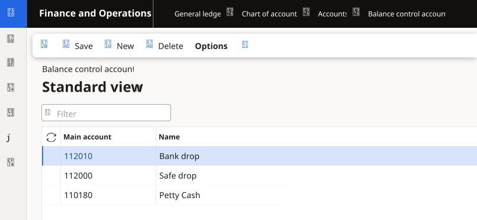

<!-- https://learn.microsoft.com/en-us/training/modules/general-ledger-daily-procedures-dyn365-finance/2-balance-control-accounts -->
# Using balance control accounts

Completed

* 10 minutes

You'll use balance control accounts to monitor the current and expected balance on an account as transactions are entered in a journal.

It is not a required setup, but it is helpful if you want to view and make sure that the funds within an account are enough to post the transaction. This will only be used for that subset of accounts where it makes sense to do so. Most commonly, for bank accounts used for disbursements.

Consider the following scenario.

The Adventure Works Cycles Accounting manager, Johnathan wants to track the current and expected balance of liquidity accounts. These include bank accounts and petty cash accounts. After Johnathan has set up the balance control accounts, then the accounts payable coordinator verifies the expected balance of the bank account to make sure that the balance is enough to pay invoices. The expected balance is going to include both posted and unposted journals.

To create balance control accounts, go to **General ledger > Chart of accounts > Accounts > Balance control accounts**.

It's important to know that a balance control account relates to a ledger account, such as a petty cash account. The bank accounts that are set up in cash and bank management are already considered balance control accounts, and by implication, the main accounts associated with them are already considered balance control accounts.

Watch the video to learn how to use:

* Journal descriptions or journal line text.
* The debit and credit proposal (**DB/CR default**) and the debit and credit requirement (**DB/CR requirement**) fields on the main account.
* Balance control account setup and inquiry.

You can view the balance control in the general journals prior to posting by using the **Inquiries > Balance control** as you see below:

The result of this inquiry shows the balance of the accounts that the journal lines trying to post amounts to and compare it with the values before and after posting the journal. This will give a glance of what will happen if you post the journal.