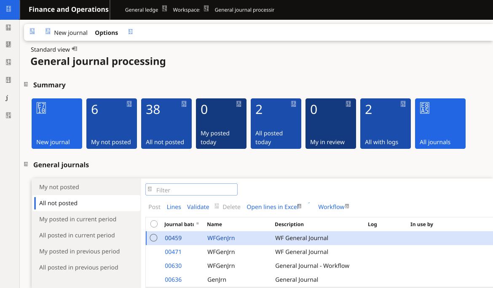
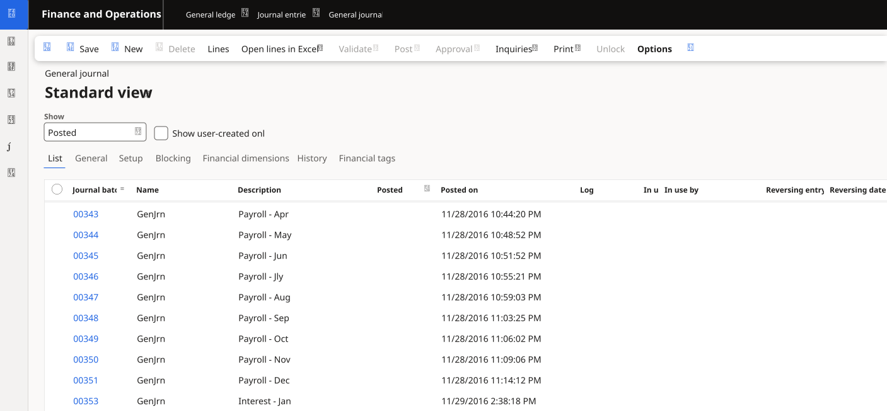

<!-- https://learn.microsoft.com/en-us/training/modules/general-ledger-daily-procedures-dyn365-finance/3-process-journal-entry -->
# Process a journal entry

Completed

* 15 minutes

In a general journal, enter transaction information such as the posting date, amount, ledger account, and offset account. At a minimum, you must specify a ledger account, a debit or credit amount, and an offset account.

You must have the following information to create a journal entry:

* Accounting date
* Ledger account
* Debit or credit amount
* Offset account (can be entered on the same line or multiple lines)

Use the **Journal lines** page to enter journal transactions. To open the page, select **Lines** on the **General journal processing page**.

**You can post transactions to the following accounts by using a general journal**:

* **Ledger** - For transactions in a ledger account.
* **Bank** – If a bank account transaction is involved.
* **Customer** - For transactions to customers.
* **Vendor** - For posting to a vendor account. For example, when you record a vendor payment and specify Vendor as the Account type, posting occurs in the specified vendor account. At the same time, posting occurs automatically in the vendor summary account in the General ledger.
* **Projects** - To post to a specific project number.
* **Fixed assets** - To post to a specific asset number.

Information in a general journal can be modified until the journal is posted. You can leave the journal and return later without losing your work.

The journal name is an exception. You can change it only before the journal header is committed. After the header is committed, the name is locked to preserve data consistency and associated control settings.

If you create a journal with the wrong name, update the description to indicate that it shouldn't be used, remove the lines, and create a new journal with the correct name. If the journal contains many lines, you can import them into the new journal by using the Excel add-in.

You can create a new general journal from the **General journal processing** workspace or from **General ledger** > **Journal entries** > **General journals** and **General ledger** > **Journal entries** > **Global general journals**.

The **General journal processing** workspace lets you create new journals, view existing journals, and open the **General journals** page.

When you create a new journal as type Daily, for instance, the journal header consists of different tabs. The **Posted** check box is selected automatically after the journal has been posted. The **General journal** page filters journals by the **Show** field. You can select to display only open, all, or posted journals.

The **General** tab shows various information, such as description, journal name, posting layer, detail level, line limits, and whether the journal is for a reversing entry.

The **Setup** tab shows the account type, whether amounts include sales tax, and options for overriding the exchange rate when multiple currencies are used.

You can also configure a default offset account by using the **Journal names** page. When a default offset account is configured, the field is populated automatically.

The **Blocking** tab shows if this journal has been blocked by an error, which will turn the **Locked by system** option on, or if it is blocked by another user. Alternatively, you can make the journal private for a user or group of users.

The **Financial dimension** tab lets you use default financial dimensions. The history section shows who modified the journal.

Finance determines the fiscal period based on the date that you enter on the journal line. If the period is closed or on hold, an error message indicates that the date can't be used.

Watch this video to learn more about the journal header tabs and their properties.