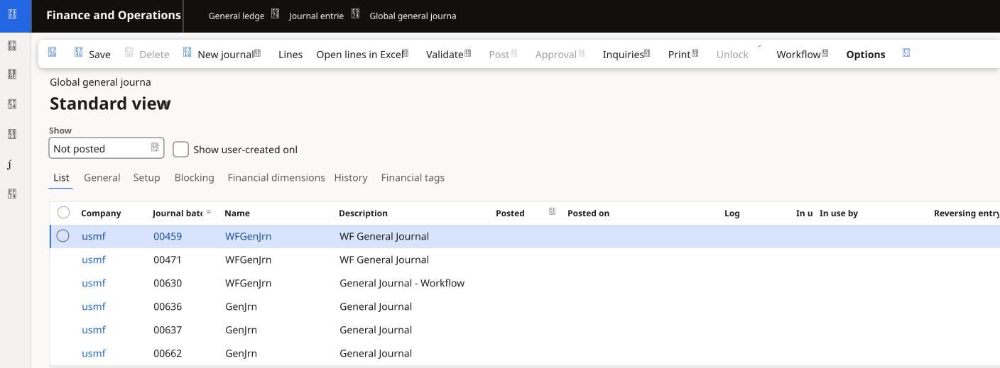
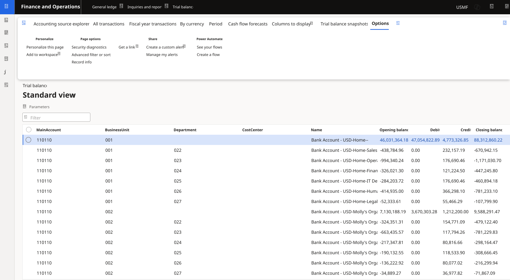

<!-- https://learn.microsoft.com/en-us/training/modules/general-ledger-daily-procedures-dyn365-finance/4-gl-processes -->
<!-- refetched: original harvest URL returned 404 -->
# Work with general ledger processes

Completed

* 12 minutes

Use the general ledger to define and manage your organization’s financial records. The general ledger is a register of debit and credit entries. These entries are classified using the accounts that are listed in a chart of accounts.

You can allocate, or distribute, monetary amounts to one or more accounts or account and dimension combinations based on allocation rules. There are two types of allocations: fixed and variable.

You can also settle transactions between ledger accounts and revalue currency amounts. At the end of a fiscal year, you must generate closing transactions and prepare your accounts for the next fiscal year. You can use the consolidation functionality to combine the financial results for several subsidiary legal entities into results for a single, consolidated organization. The subsidiaries can be in the same Finance database or in separate databases.

Transactions are recorded in a journal at least once a month. Each transaction is marked with the number of the journal it was recorded in, and the line number.

To ensure that the transactions also get a date and time stamp of their entry in the journal, select the **Extended ledger journal** check box on the **General ledger parameters** page.

All further transactions occur in the next journal. Therefore, it is important to always include all open periods in the journal.

1. Select **General ledger > Periodic tasks > Journalizing**.
2. To enter a range of vouchers or dates to journalize, select **Select**. You should journalize all available transactions.
3. Select **OK**.
4. If the message appears that the setup changed. Select **Yes**.
5. Select **OK** to print the **Extended journal list**.

Aside from journalizing, consider the other processes that you can perform in General ledger:

* **Process closing transactions** - For more information, see [Configure and perform periodic processes in Dynamics 365 Finance](/en-us/training/modules/configure-periodic-processes-dyn365-finance/?azure-portal=true).
* **Allocate transactions** - For more information, see [Configure ledger allocations and accruals in Dynamics 365 Finance](/en-us/training/modules/configure-ledger-allocations-accruals-dyn365-finance/?azure-portal=true).
* **Maintain ledger accounts** - For more information, see [Configure chart of accounts in Dynamics 365 Finance](/en-us/training/modules/configure-chart-accounts-dyn365-finance/?azure-portal=true).
* **Close transactions** - For more information, see [Configure and perform periodic processes in Dynamics 365 Finance](/en-us/training/modules/configure-periodic-processes-dyn365-finance/?azure-portal=true).
* **Allocate costs and income** - For more information, see [Configure ledger allocations and accruals in Dynamics 365 Finance](/en-us/training/modules/configure-ledger-allocations-accruals-dyn365-finance/?azure-portal=true).
* **Forecast cash flow and currency requirements** - For more information, see [Configure chart of accounts in Dynamics 365 Finance](/en-us/training/modules/configure-chart-accounts-dyn365-finance/?azure-portal=true).
* **Eliminate transactions** - For more information, see [Configure and perform periodic processes in Dynamics 365 Finance](/en-us/training/modules/configure-periodic-processes-dyn365-finance/?azure-portal=true).
* **Revalue currency amounts** - For more information, see [Configure and perform periodic processes in Dynamics 365 Finance](/en-us/training/modules/configure-periodic-processes-dyn365-finance/?azure-portal=true).
* **Convert accounting currency** - For more information, see [Configure currencies in Dynamics 365 Finance](/en-us/training/modules/configure-currencies-dyn365-finance/?azure-portal=true).
* **Prepare pre-closing reports** - For more information, see [Configure and perform periodic processes in Dynamics 365 Finance](/en-us/training/modules/configure-periodic-processes-dyn365-finance/?azure-portal=true).
* **Create electronic documents** - For more information, see [Configure electronic reporting in Dynamics 365 Finance](/en-us/training/modules/configure-electronic-reporting-finance-operations/?azure-portal=true).
* **Close books** - For more information, see [Configure and perform periodic processes in Dynamics 365 Finance](/en-us/training/modules/configure-periodic-processes-dyn365-finance/?azure-portal=true).
* **Close the month, period, and fiscal year** - For more information, see [Configure and perform periodic processes in Dynamics 365 Finance](/en-us/training/modules/configure-periodic-processes-dyn365-finance/?azure-portal=true).

## Dual currency

The reporting currency is a true second accounting currency. From a general ledger perspective, this means that the reporting currency is calculated for every transaction posted to the general ledger. A new journal is added to post transactions in only the reporting currency.

For various subledgers, such as fixed assets, you can maintain all transactions in the subledger for the reporting currency. When running depreciation, it depreciates the reporting currency amounts using the depreciation methods, just as it does the accounting currency.

## Data entry for dimension values

When a dimension has a backing entity such as customer or vendor, the dimension value defaults to the value entered in the associated form. For example, the customer dimension is automatically set to the customer value used when a customer is created. Options are available to enable one or more dimensions to be the default. For example, a business unit can be the default when the cost center is entered.

## Reporting currency in financial reporting

The reporting currency in the Ledger setup in General ledger is available as a currency display in the column definition in Financial reporting. This allows you to take advantage of the powerful currency translation capabilities of Financial reporting, and report on the reporting currency from Finance.

The Currency display drop-down labels describe what is being reported on: Accounting currency from Ledger setup, Reporting currency from Ledger setup, Transaction currency, or Translate to.

## Global General Ledger journals

Use **General ledger > Journal entries > Global general journals** to assign the security role access to all General journals and all companies. If you create a journal in one specific company, and switch to another company, you have the visibility to see all the general journals.

Watch this video to learn how to work with Global general journals.

## Posting multiple Journals

Finance can post multiple journals with large processes in a batch. You can also post multiple journals that you've created in not only general ledger but also in accounts receivable, accounts payable, projects, and fixed assets. You can post journals immediately or set them up as a job for batch processing.

You can use the **Post journals** menu option to post multiple journals with large processes in a batch. You can also post multiple journals that you have created in the following modules by selecting the **Post journals** menu option:

* General ledger
* Accounts receivable
* Accounts payable
* Project

If you’re using batch job processing, select the **Late selection** check box to build a query, and to have the system use all journals that meet the criteria for posting when the batch is run. By selecting this check box, the journal doesn't have to exist before being selected for the batch processing job.

## Line limits

If Lines limit is set up on the **Journal names** page, you might need to create several journals during posting. The number of the first journal posted is saved automatically in each associated journal.

## Post and transfer

If a journal has vouchers with errors, you still can post the journals for those vouchers, which are validated before they are transferred with errors.

Different lines can be on different dates. The voucher number for the line is assigned based on the criteria for number sequencing in the journal name.

When you select **Functions > Post and transfer** from the journal header menu, Finance posts all the journals that don't have errors, and transfers those vouchers with errors into a new journal, where you can then correct the error and post later.

## Journals with workflow approval

Finance provides out-of-the-box workflows for general ledger journals. You must first create a workflow for the ledger daily journal, and then process the journal and go through the approval process.

## Periodic journals

A periodic journal only has data entered periodically. For example, during each month at accounting close, a user makes the same entry with the same account numbers in currency amounts. The user sets up a periodic journal to make this process quicker. Then each month, the user retrieves the journal and posts it with the appropriate accounting date.

## General ledger account balances

The trial balance is a list page that shows all the balances of an account and/or dimensions for a given period of time. To see the **Trial balance page**, go to
**General ledger > Inquiries and reports > Trial balance**. When the trial balance is first opened it refreshes with the balances for the dates and properties that are set in the Parameters. Properties that can be changed in Parameters are the dates, posting layer, how the opening balances should appear, and what closing transaction types should display. The dates specified must be in same fiscal year when you calculate the trial balance.

When you change the parameters, the balances are refreshed. You can also pick which dimension set that you want to view balances for and whether each of the dimensions show in separate columns.
You can drill down on the balances to view the transactions that make up the balance.

## Performance

To troubleshoot performance issues when you post financial journals, see [Financial journal posting performance](/en-us/dynamics365/finance/general-ledger/posting-performance?azure-portal=true)