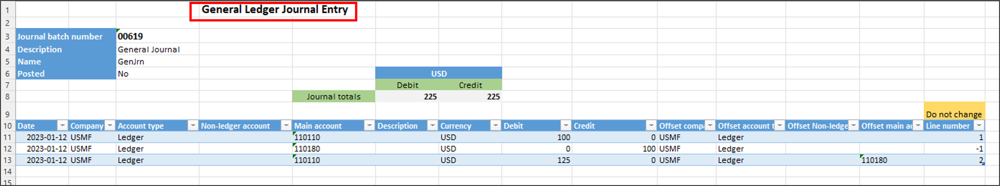

<!-- https://learn.microsoft.com/en-us/training/modules/general-ledger-daily-procedures-dyn365-finance/create-templates -->
# Create templates to edit journals in Microsoft Excel

Completed

* 7 minutes

In Dynamics 365 Finance, you can open journals in Microsoft Excel by using the Excel Data Connector add-in, which is based on the OData integration protocol. Predefined templates are already available, which you can use to enter journal lines in Excel and then publish them to the journals. These templates can support specific account types only.

## Ledger journal lines

Ledger journal lines are applicable to the General journal in the **General ledger** module. You can open the **General journal** page and find the **Open in Microsoft Office** icon.

After you've selected the icon, you'll find the General journal line entry template under the **Open In Excel** option. When you select the template, a spreadsheet will download from Finance.

You can add more lines and update existing lines on the spreadsheet. When you're finished, you'll need to publish the data, which will transfer all new or updated lines to the General journal.

This template supports Ledger, Customer, Vendor, and Bank as main account and offset account. This template also supports intercompany transactions.

## Invoice register

The Vendor invoice register is applicable to the Invoice register in the **Accounts payable** module. Open the **Invoice register** page and then find the **Open in Microsoft Office** icon.

After you've selected the icon, you can find the **Vendor invoice register** template under the **Open In Excel** option. When you select the template, a spreadsheet will download from Finance.

You can add more lines and update existing lines in the **Vendor invoice register** template. When you're finished, you'll need to publish the data, which will transfer all new or updated lines to the Vendor invoice register.

This template supports Vendor as the main account and Ledger as the offset account. This template doesn't support intercompany transactions.

## Invoice journal

Vendor invoice journal is applicable to the Invoice journal in the **Accounts payable** module. Open the **Invoice journal** page and then find the **Open in Microsoft Office** icon.

After you've selected the icon, you'll find the **Vendor invoice journal** template under the **Open In Excel** option. When you select the template, a spreadsheet will download from Finance.

You can add more lines and update existing lines on the **Vendor invoice journal** template. When you're finished, you'll need to publish the data, which will transfer all new or updated lines to the vendor invoice journal.

This template supports Vendor as the main account and Ledger as the offset account. This template supports intercompany transactions.

## Vendor invoice

Vendor invoice templates are applicable to Vendor invoice in the **Accounts payable** module. Open the **Vendor invoice** page and then find the **Open in Microsoft Office** icon.

After you've selected the icon, you'll find the **Vendor invoice** template under the **Open In Excel** option. When you select the template, a spreadsheet will download from Finance.

You can add more lines and update existing lines on the **Vendor invoice** template. When you're finished, you'll need to publish the data, which will transfer all new or updated lines to the vendor invoice.

## Free text invoice

Free text invoice templates are applicable to Free text invoice in the **Accounts receivable** module. Open the **Free text invoice** page and then find the **Open in Microsoft Office** icon.

After you've selected the icon, you'll find the **Free Text Invoice** template under the **Open In Excel** option when you select **Invoice**. When you select the template, a spreadsheet will download from Finance.

You can add more lines and update existing lines on the **Free Text Invoice** template. When you're finished, you'll need to publish the data, which will transfer all new or updated lines to the free text invoice.

## Fixed asset journal

Fixed asset journal templates are applicable to Fixed asset journal in the **Fixed asset** module. Open the **Fixed asset journal** page and then find the **Open in Microsoft Office** icon.

After you've selected the icon, you'll find the **Fixed asset journal line** template under the **Open In Excel** option. When you select the template, a spreadsheet will download from Finance.

You can add more lines and update existing lines on the **Fixed asset journal line** template. When you're finished, you'll need to publish the data, which will transfer all new or updated lines to the fixed asset journal.

This template supports Ledger, Bank, Customer, or Vendor as the main account. This template doesn't support intercompany transactions.

## Vendor payment journal

Vendor payment journal templates are applicable to Vendor payment journal in the **Accounts payable** module. Open the **Vendor payment journal** page and then find the **Open in Microsoft Office** icon.

After you've selected the icon, you'll find the **Vendor payment journal** template under the **Open In Excel** option. When you select the template, a spreadsheet will download from Finance.

You can add more lines and update existing lines on the **Vendor payment journal** template. When you've finished, you'll need to publish the data, which will transfer all new or updated lines to the vendor payment journal.

This template supports Vendor as the main account and Ledger and Bank as offset accounts. This template supports intercompany transactions.

## Customer payment journal

Customer payment journal templates are applicable to the Customer payment journal in the **Accounts receivable** module. Open the **Customer payment journal** page and then find the **Open in Microsoft Office** icon.

After you've selected the icon, you'll find the **Customer payment journal** template under the **Open In Excel** option. When you select the template, a spreadsheet will download from Finance.

You can add more lines and update existing lines on the **Customer payment journal** template. When you're finished, you'll need to publish the data, which will transfer all new or updated lines to the customer payment journal.

This template supports Customer as the main account and Bank as the offset account. This template supports intercompany transactions.

## Project expense journal

Project expense journal templates are applicable to Project expense journal in the **Project management and accounting** module. Open the **Project expense journal** page and then find the **Open in Microsoft Office** icon.

After you've selected the icon, you'll find the **Journal lines for Project – expenses entry** template under the **Open In Excel** option. When you select the template, a spreadsheet will download from Finance.

You can add more lines and update existing lines on the **Journal lines for Project – expenses entry** template. When you're finished, you'll need to publish the data, which will transfer all new or updated lines to the Project expense journal.

This template supports Project, Ledger, Customer, and Vendor as main accounts and as offset accounts. This template supports intercompany transactions.