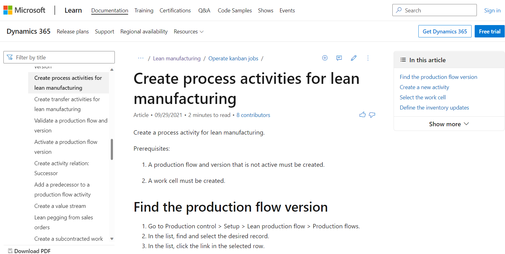

<!-- https://learn.microsoft.com/en-us/training/modules/get-help-finance-operations/3-docs-site -->
<!-- refetched: original harvest URL returned 404 -->
# Microsoft Learn documentation

Completed

* 5 minutes

The [Finance and operations application documentation](/en-us/dynamics365/fin-ops-core/fin-ops/?azure-portal=true) on Microsoft Learn is the primary source of product help for finance and operations apps.

Microsoft Learn documentation provides:

* A rich set of product Help topics that can be enhanced by community members both inside and outside Microsoft.
* A quick way to access different types of content about the system, including topics and videos.

The Microsoft Learn documentation website is fully public, and sign-in isn't required to search it. You can use your favorite search engine to find content.

Here's an example of a Microsoft Learn documentation article about lean manufacturing:

If you have a suggestion about the documentation, you're welcome to sign in to leave us feedback. You can even edit the documentation yourself.

To contribute content or suggest a change, you need a GitHub account, and you also need to sign a Contributor License Agreement. After you submit your proposed changes, they are reviewed.

For more information about contributing and the Help system, see [Contribute to Dynamics 365 documentation](/en-us/dynamics365/get-started/contribute/?azure-portal=true), and [Help system](/en-us/dynamics365/fin-ops-core/fin-ops/get-started/help-overview/?azure-portal=true).