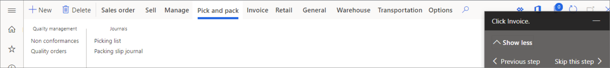

<!-- https://learn.microsoft.com/en-us/training/modules/get-help-finance-operations/4-in-product-help -->
# In-product help

Completed

* 3 minutes

You can see field descriptions in the user interface (UI). Additionally, from the **Help** pane, you can access both topics in Microsoft Learn documentation and in task guides.

## View and export field descriptions

You can view field descriptions in the UI by hovering over a field. You can also use the **Field descriptions** page to view and export field descriptions for a specific page.

For more information, see [View and export field descriptions](/en-us/dynamics365/fin-ops-core/fin-ops/get-started/view-export-field-descriptions/?azure-portal=true).

## Access topics in Microsoft Learn documentation

To open the **Help** pane in finance and operations apps, you can either select the **Help** button (**?**) and then select **Help**, or press Ctrl+Shift+?. From the **Help** pane, you can access both topics in Microsoft Learn documentation and in task guides.

When you first open the **Help** pane, the **Help** tab shows a list of the topics that apply to the page that you're currently on in finance and operations apps. If no topics are found, you can search for the content that interests you.

When you select a topic title in the **Help** pane, the topic is opened on a new browser tab.

## Access task guides

A **task guide** is a controlled, guided, interactive experience that leads you through the steps of a task or business process. You can open and play task guides from the **Help** pane.

Open the **Help** pane, and select the **Task Guides** tab. You'll see a list of task guides that apply to the page that you're currently on in finance and operations apps. If no task guides are found, you can enter keywords to refine your search.

If you don't see any task guides, you might need to ask a system admin to set up the Help system for your organization.

When you first select a task guide, the **Help** pane shows the step-by-step instructions for the task. To begin the guided, interactive experience, select **Start task guide** at the bottom of the **Help** pane. A black pointer appears and indicates the actions that you must perform. Follow the directions that appear in the UI, and enter data as directed.

The following screenshot shows how the task guide points out what to do next in a procedure.

Note

The data that you enter when you play a task guide is real. If you're in a production environment, the data will be entered in the company that you're currently using.