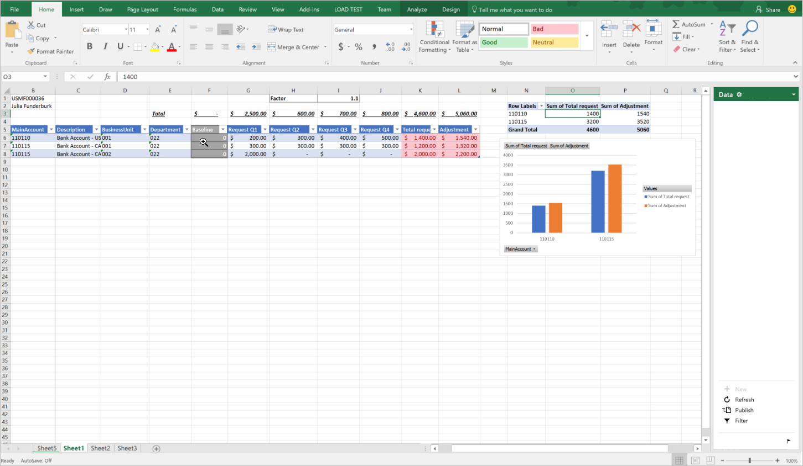

<!-- https://learn.microsoft.com/en-us/training/modules/get-started-financial-management-dyn365-finance/2-benefits -->
<!-- refetched: original harvest URL returned 404 -->
# Benefits of Dynamics 365 Finance

Completed

* 5 minutes

Finance helps
companies accelerate their business growth and elevate their financial
performance.

## Accelerate your business growth

Finance helps businesses adapt quickly to changing market
demands and drive rapid business growth by providing unified global financials
and operations features to empower people to make fast, informed
decisions.

By using built-in controls, financial leaders can gain insight into their financial data, have 360-degree visibility across all operating units, such as departments and cost centers, and make intelligent
decisions to stay competitive in today's fast and ever-changing global market.

## Elevate your financial performance

Finance helps companies drive margin revenue growth with
a centralized, global financial management solution that delivers robust
financial intelligence and embedded analytics in real time to help
increase profitability.

Finance uses a modern, user-friendly interface design that is
flexible enough to run on any device and platform that supports
Microsoft technology. Mobile devices are now a part of people's daily
lives, and employees can use their devices to access and use Finance anytime and anywhere in a secure environment.

Finance empowers employees with role-based workspaces
that provide intelligent automation, task prioritization, and
integration with Microsoft 365 applications to maximize
efficiency for positive business outcomes.

Microsoft Excel is the most popular tool among finance users.
Employees can open data from any page in Finance in
Excel, manipulate data, and publish the data back to Finance.

Businesses can reduce operational expense by minimizing operational
costs across business geographies with financial process automation,
encumbrance, budget planning, budget control, and three-way matching.

The ever-changing market demands that companies adapt quickly to
market-driven requirement changes while staying competitive and
profitable.

You can adjust to changing financial requirements with a flexible,
guided, rules-based chart of accounts, dimensions, and global tax engine
in Finance.

Finance provides companies with functionality to
streamline asset management, efficiently track values, and reduce
reporting errors with centralized, automated processes for managing your
capitalized assets from acquisition through disposal.