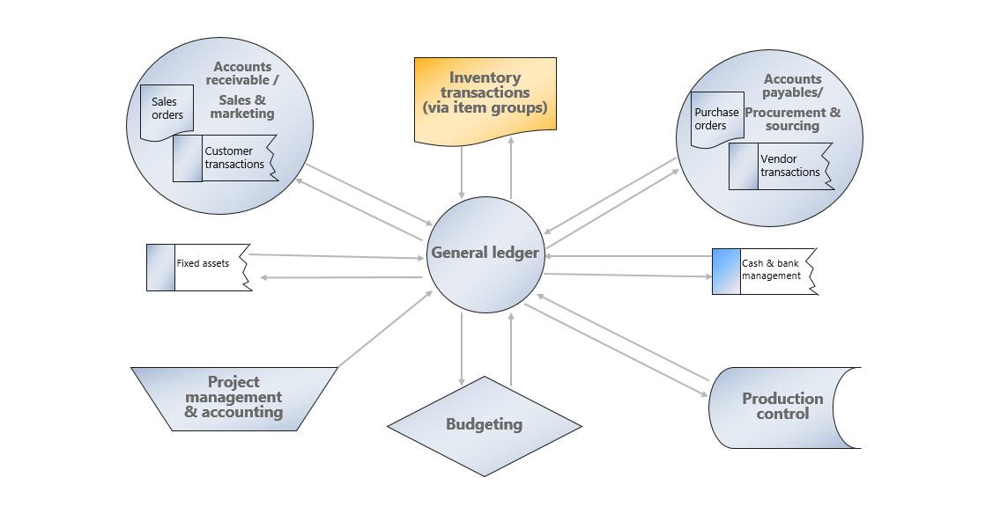

<!-- https://learn.microsoft.com/en-us/training/modules/get-started-financial-management-dyn365-finance/3-overview -->
# Overview

Completed

* 6 minutes

Two objectives of a typical financial management system in any company
are:

* **Maximize profit** - Trying to earn maximum profits for the
  company in the short term and the long term. Finance
  keeps all financial transactions in a ledger, and also offers tools and
  features to provide insight into incurring costs and projected revenue
  so that financial leaders can make proper decisions.

  + The General ledger module is the core of Finance and is
    integrated with other sub ledgers in Finance.
  + The Cash and bank management module allows companies to manage
    their banks and balances, and reconcile the bank statements
    with the General ledger module.
* **Maximize wealth** - Earning maximum wealth for the
  shareholders of the company by increasing the market value of the
  shares, which is directly related to the performance of the company.
  A company must have a good cash flow to pay the daily expenses such
  as purchase of raw materials, wages, rent, electricity bills, and
  more. If the company has good cash flow, it can take advantage of
  many opportunities such as getting cash discounts on purchases,
  making large-scale purchases, giving credit to customers, and more. A
  healthy cash flow improves a company's chances of survival and success.

  Finance offers tools and features, with built-in
  intelligent controls such as charts, KPIs (key performance
  indicators), and workspaces, to give insight into a company's cash
  flow, project supply, and demand. It can analyze customer demographics and costs of goods so that a company can better negotiate
  more advantageous agreements with their vendors and customers.

  + The Accounts payable and Accounts receivable modules offer what a company
    needs to manage vendor and customer daily processes such as
    invoicing and generating or collecting payments.
  + The Budgeting module lets a company properly estimate the total
    financial requirements by determining how much finance is
    necessary to operate and what the requirements are for fixed and
    working capital.
  + The Sales and marketing, Inventory management, Procurement and
    sourcing, Cost management, and Cost control modules in Dynamics 365 Supply Chain Management all
    contribute to making proper decisions to maximize the wealth in
    a company.

  

As the figure illustrates, the General ledger module interacts with
other modules in the following scenarios:

* **Cash and bank management** - All incoming and outgoing funds will
  be recorded in the general ledger, and each bank has a corresponding
  account in the general ledger chart of accounts. Therefore, this module simplifies your ability to reconcile bank statements with financial management transactions in periodic processing.
* **Accounts payable** - All invoices and payment transactions are
  recorded in the general ledger. The Accounts payable clerk matches
  the purchase order with the recorded invoice to determine if the vendor
  invoice is qualified to be paid and, upon the due date, generates
  payments, which through the general ledger will impact cash and bank
  management.

  
* **Project management and accounting** - Based on time and materials
  or a fixed price project, purchases often need to be made. In this
  case, the Project management and accounting module can interact with
  the Procurement and sourcing module in Supply Chain Management to generate purchase orders,
  which will then be settled in the Accounts payable module in Finance.

  During project implementation, you can create invoices for
  customers, and then a Sales and marketing department will continue
  managing the quotations and converting them to invoices for ongoing
  projects, alongside their typical role of marketing goods
  and managing sales. Then, the Accounts receivable module will
  manage the customer payments and, perhaps, refunds.

  

The next units will cover each module in Finance.