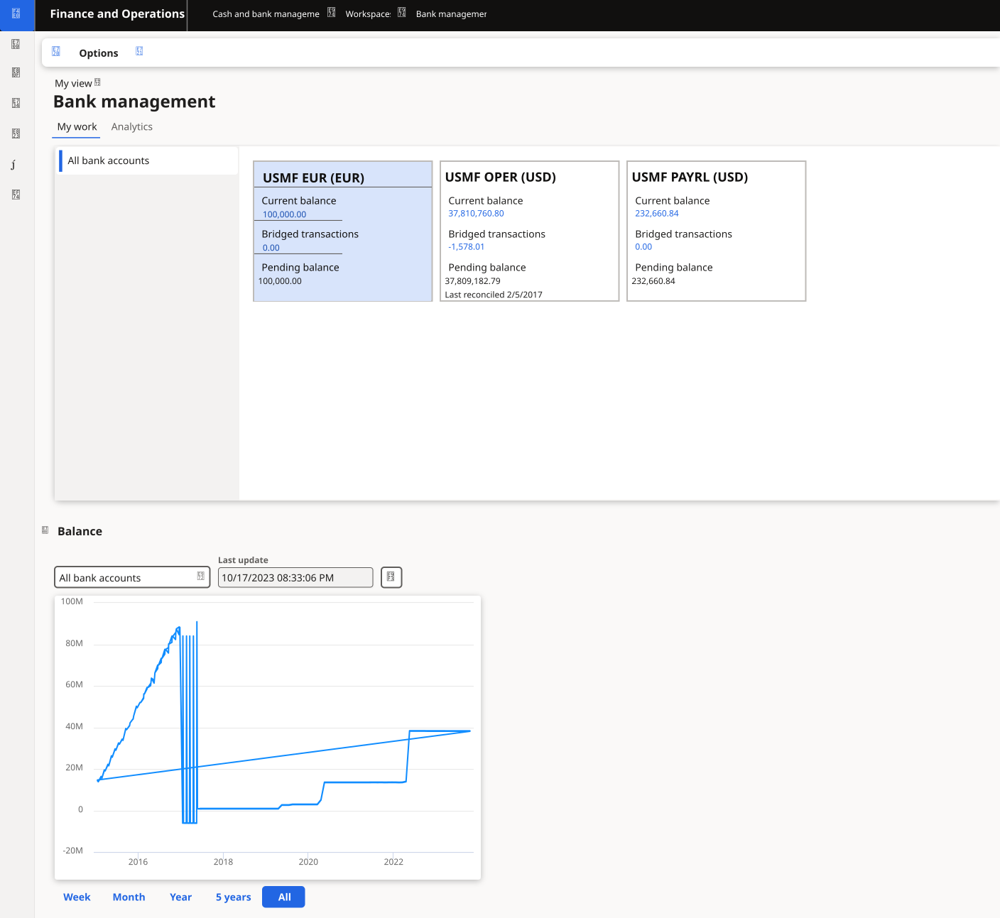

<!-- https://learn.microsoft.com/en-us/training/modules/get-started-financial-management-dyn365-finance/5-cash-bank -->
<!-- refetched: original harvest URL returned 404 -->
# Cash and bank management

Completed

* 5 minutes

You can use the Cash and bank management module in Finance to maintain a company's
bank accounts and the financial instruments that are associated with
those bank accounts. These instruments include deposit slips, checks,
bills of exchange, and promissory notes. You can also reconcile bank
statements and print bank data on standard reports.

The following are examples of tasks that you can perform in the
Cash and bank management module:

* Manage letters of credit and import collections for the purchase and sale of goods across international borders.
* Manage letters of guarantee to manage agreement by a bank (the guarantor) to pay a set amount of money to some person (the beneficiary).
* Perform bank reconciliation by importing bank statements and by using matching rule criteria to automatically select transactions for reconciliation, which saves significant time for accountants.
* Deposit and transfer bank funds.
* Cancel wrong deposits.
* Update and maintain bank balances.
* Define formats for checks.
* Use the cash flow forecasting tools to analyze upcoming cash flow and currency requirements so that you can estimate the company's future need for cash.