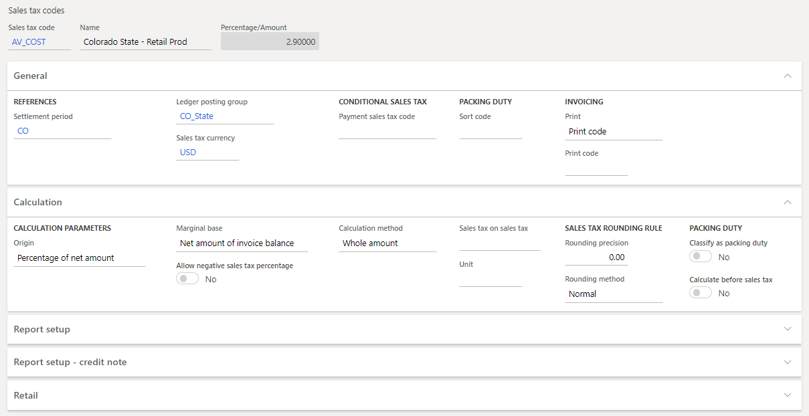

<!-- https://learn.microsoft.com/en-us/training/modules/get-started-financial-management-dyn365-finance/6-tax -->
# Tax

Completed

* 5 minutes

Every company must collect and pay taxes to various tax authorities.
The rules and rates vary by country or region, state, county, and city.

Also, the rules must be updated periodically when tax authorities change
their requirements.

Sales tax codes contain the basic information about how much you collect
and pay to the authorities. When setting up sales tax codes, you define
the amounts or percentages that must be collected. You also define the
various methods by which those amounts or percentages are applied to
transaction amounts.

The sales tax framework supports many types of indirect taxes, such as
sales tax, value-added tax (VAT), goods and services tax (GST),
unit-based fees, and withholding tax. These taxes are calculated and
documented during purchase and sales transactions. Periodically, they
must be reported and paid to tax authorities.