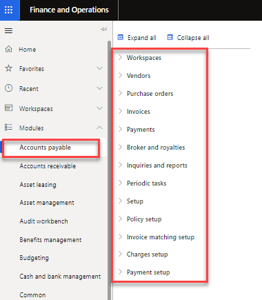

<!-- https://learn.microsoft.com/en-us/training/modules/get-started-financial-management-dyn365-finance/7-ap -->
<!-- refetched: original harvest URL returned 404 -->
# Accounts payable

Completed

* 5 minutes

The Accounts payable module in Finance lets you set up vendor groups, vendors,
posting profiles, various payment options and parameters regarding
vendors, charges, deliveries and destinations, promissory notes, and
other types of accounts payable information.

You can also set up accounts payable to record vendor invoices,
generate and post vendor payments, and perform settlements.

The following are examples of tasks that you can perform in the
Accounts payable module:

* Enter vendor invoices manually or receive them electronically through a data entity. After the invoices are entered or received, you can review and approve the invoices by using an invoice approval journal or the **Vendor invoice** page.
* Use invoice matching, vendor invoice policies, and workflow to automate the review process so that invoices that meet certain criteria are automatically approved, and the remaining invoices are flagged for review by an authorized user.
* Resolve discrepancies during invoice totals matching.
* Set up default offset accounts for vendor invoice journals and an invoice approval journal.
* Manage daily tasks by using workspaces.
* Define vendor payment terms and fees.
* Set up and generate positive pay files.
* Create vendor payments by using a payment proposal.
* Credit vendor payments for a partial amount.
* Take a cash discount outside the cash discount period.
* Reverse a vendor payment.
* Prepare prepayment invoices and a prepayments overview.
* Settle a partial vendor payment before the discount date.