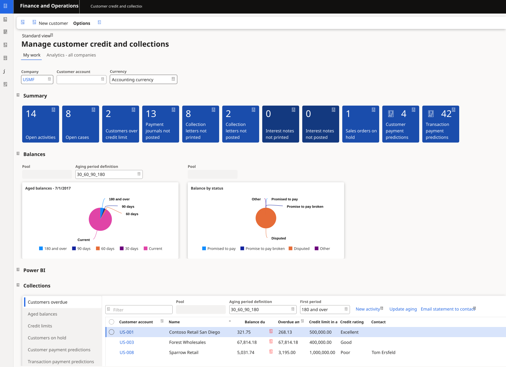

<!-- https://learn.microsoft.com/en-us/training/modules/get-started-financial-management-dyn365-finance/9-credit-collections -->
# Credit and collections

Completed

* 5 minutes

Accounts receivable collections information can be managed in one central
view by using the **Collections** page in Finance.

Collection agents can begin the collections process from generated customer lists
by using predefined collection criteria, or from the
**Customers** page.

Before you begin to set up or work with collections, you should understand the following concepts:

* Customer aging snapshots contain aged balance information at a point in time.
* Collections customer pools help you organize your work.
* Collections agents can have their own customer pools.
* List pages organize collections customers, activities, and cases.
* All collections information for a customer is on one page and you can take action from that page.
* Waiving, reinstating, or reversing interest and fees can be done in one step.
* You can manage delinquent customers.
* You can create write-off transactions in one step.
* Processing Not Sufficient Funds (NSF) payments can be done in one step.

Collections agents can also use the **Collections coordinator** workspace, which brings a customer's aged balances, open transactions, disputed invoices, promised payments, unsettled payments, customer timeline, and contact details together on a single page. For more information, see [Collections coordinator workspace](/en-us/dynamics365/finance/accounts-receivable/collectionsworkspace/?azure-portal=true).