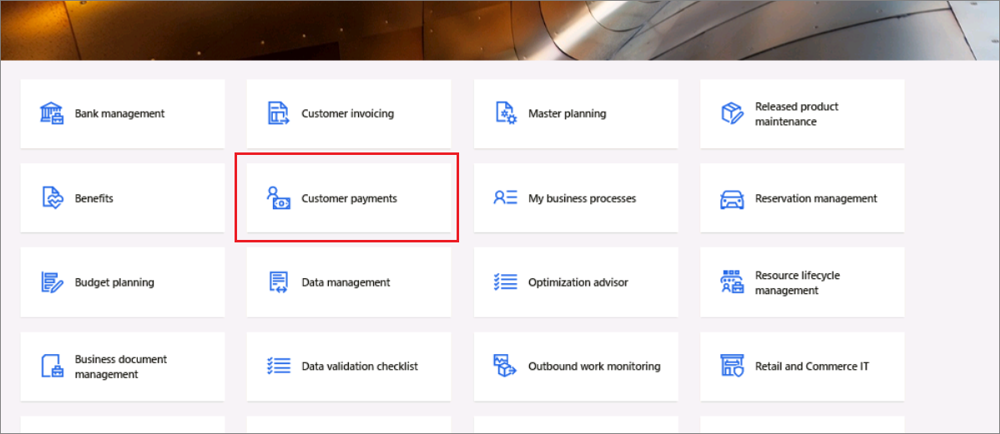
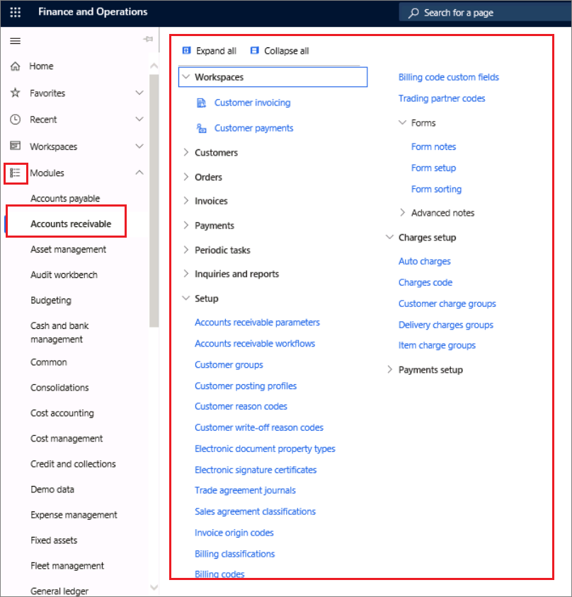

<!-- https://learn.microsoft.com/en-us/training/modules/get-started-financial-management-dyn365-finance/12-1-exercise -->
# Exercise - Explore Dynamics 365 Finance

Completed

* 15 minutes

## Scenario

Now that you've learned about the basics of Dynamics 365 Finance, and the modules and features that it includes, it’s your turn to explore.

1. After you've logged in to the lab environment, by following the instructions above, you can select tiles on the **Home** page to open workspaces. For example, **Customer payments** will open the **Customer payments** workspace.

   

   You close a workspace by selecting the **X** in the top right of the page.
2. Select the **Modules** icon in the navigation pane on the left, and open a module and explore the many pages in that module. For example, **Accounts receivable**.

   

   Note

   In this lab environment, there are more Dynamics 365 apps installed than Dynamics 365 Finance. Therefore, you will also see modules that are not part of Finance.
3. When have finished exploring Dynamics 365 Finance, you can close the lab environment and return to the training module.