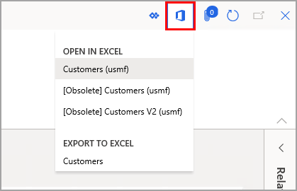

<!-- https://learn.microsoft.com/en-us/training/modules/implement-common-integration-features-finance-ops/2-office -->
<!-- refetched: original harvest URL returned 404 -->
# Microsoft Office integration

Completed

* 12 minutes

You can use Microsoft Office integration in finance and operations apps to export data into Excel. After modification, if necessary, you will be able to publish it back, and then create an Excel workbook as a template by using the Workbook designer.

Microsoft Office integration capabilities provide you with a productive environment that helps you get the job done by using Office products.

The **Export to Excel** options and experiences are found in the **Open in Microsoft Office** menu.

* The **Export to Excel** options are static exports of grid data. Each one corresponds to a visible grid. All grid data for the current filter is placed into a workbook.
* The **Open in Excel** experiences use the Excel add-in to facilitate refresh and publish.

## Static Export to Excel

Static Export to Excel provides a quick mechanism for getting data into grids on a page. The standard mechanism for triggering Export to Excel is the **Open in Microsoft Office** menu. Static Export to Excel is also available via a shortcut menu on the grid.

## Generated Open in Excel

Generated **Open in Excel** options are automatically added to pages when the system finds data entities that have the same root data source as the page. The workbook that is generated will contain a single table data source where the data from that entity is loaded.

The **Open in Excel** experiences are listed on the **Open in Microsoft Office** menu. When an entity has the same root data source as a page, it's added as an option in the **Open in Excel** section of the **Open in Microsoft Office** menu. This is referred to as a generated option.

The Excel app has a design experience that lets users add and edit bindings to entity data sources and labels.

## Open in Excel Online

The Excel app is built by using the Apps for Office framework. This framework provides a JavaScript-based web application programming interface (API) that enables apps to communicate with Office applications.

The biggest advantage of this framework is that apps can run in on-premises Excel instances (Win32), Excel Online (Microsoft 365), and Excel on the Apple iPad.

To facilitate data entry, the Excel app provides lookups and data assistance. Date fields provide a date picker, enumeration (enum) fields provide an enum list, and relationships provide a relationship lookup.

## Template Open in Excel

Template options resemble the generated **Open in Excel** options. They are automatically added to pages when the system finds templates that have the same first data source as the root data source in the page. These templates are stored in the **Document templates** page.

## Excel Data Connector add-in

Excel can change and quickly analyze data. The Excel Data Connector app interacts with Excel workbooks and OData services that are created for publicly exposed data entities. The Excel Data Connector add-in enables Excel to become a seamless part of the user experience.

The Excel Data Connector add-in is built by using the Office Web add-ins framework. The add-in runs in a task pane. Office Web Add-ins are web applications that run inside an embedded internet browser window. The Excel Data Connector app is located in a task pane on the right side of a workbook. The add-in uses OAuth to facilitate authentication.

The following features are available in the connector add-in:

* **Add-in primary title** – The title of the add-in that is provided to the Office Web Add-ins framework.
* **Add-in secondary title** – The title of the add-in that is provided by the add-in.
* **Source name** – The label of the entity that provides data for the selected data table. You can hover over the label to view the corresponding name.
* **Field name** – The label of the field that provides data for the selected data table column. You can hover over the label to view the corresponding name and type.
* **Refresh button** – Refresh the data in the workbook.
* **Publish button** – Publish the data changes in the workbook.
* **Design button** – Open the design-time experience.
* **Status bar** – The status bar provides brief, temporary information alerts. Information that appears in the status bar also appears in the **Messages** dialog box.
* **Options button** – Open the **Options** dialog box.
* **Messages button** – Open the **Messages** dialog box, which displays the information messages, warnings, and errors that the program provides to the user. A number sometimes appears next to the **Messages** button to provide a count of the warnings or errors that the user might be interested in.
* **Excel data table containing data** – The filter and sort controls in the column’s headers can be used on this data. The filters must be removed before data changes are published.
* **Office Web Add-ins menu** – The **Office Web Add-ins menu** button provides several standard links. The most important of the links is used to reload the add-in. When the add-in is reloaded, it updates all the data for the workbook that is contained in tables that are associated with the add-in.

When you click in a table cell, any lookup, enumeration drop-down list, or date picker that is associated with that cell will be shown inside the add-in, underneath the source and field information. Any value that you select inside the add-in is put into the currently selected table cell.

To add a record, either start typing in a row directly below a table, or use the **Tab** key to tab away from the last cell of the last row in the table.

To delete a record, select the row by selecting the row label (1, 2, 3, and so on), and delete all the cells in that row.

To publish the changes, select **Publish**. The **Messages** dialog box shows how many records were added, edited, and deleted.

 
Watch a demonstration of the Excel Data Connector add-in in the video.