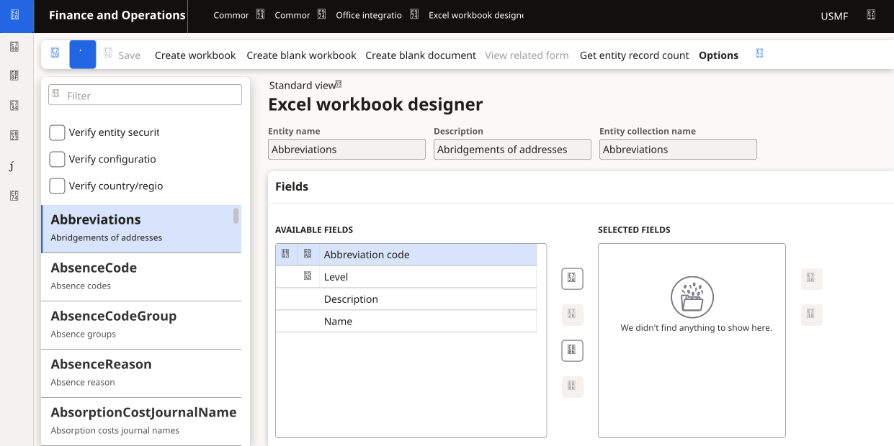

<!-- https://learn.microsoft.com/en-us/training/modules/implement-common-integration-features-finance-ops/3-excel -->
<!-- refetched: original harvest URL returned 404 -->
# Excel workbook designer

Completed

* 13 minutes

In addition to using the **Design** button in the Excel add-in, you can use the **Excel workbook designer** page to design an editable custom export workbook that contains an entity and a set of fields. To open the **Workbook designer** page, go to **Common > Common > Office Integration > Excel workbook designer**.

You can use the **Excel workbook designer** page to design an editable custom export workbook that contains an entity and a set of fields.

A workbook template can have multiple data sources. It can also have unbound content. The **Open in Excel** experiences are listed on the **Open in Microsoft Office** menu. The **Excel workbook designer** page provides an easy way to get a generated **Open in Excel** experience for an entity. It also provides a mechanism with a blank workbook that contains just the Excel app and a pointer to the server.

Before you can publish data edits, all key fields of the entity must be in the Excel table. Key fields have a key symbol next to them. To successfully create or update a record, it must have all the mandatory fields in the Excel table. Mandatory fields have an asterisk (\*) next to them.

To retrieve the resulting workbook, select **Create workbook** in the app bar. Select **View related form** to see the data that the entity exposes. This button is only enabled for entities that have a **FormRef property** value.

The default fields that will be added into the workbook are the key and mandatory fields of the entity. If a different set of fields should be provided by default, then those fields can be added into the **AutoReport field group** on the entity.

When a relationship is defined between two entities, if the identifier for one entity is shown on the other entity, then the fields that will be shown in that lookup are either the key fields, or the fields in the **AutoLookup field group** if it is not empty. Relationship lookups are not currently supported, but they will eventually be displayed in the app in a similar way to the enumeration lookups.

## Create a template by using the Excel workbook designer

The following procedure demonstrates how to export customer group data.

1. In finance and operations apps, go to **Common > Common > Office integration > Excel workbook designer**.
2. Filter for **CustomerGroup** to export customer group information.

   
3. Select the right arrow to select the required fields. See an example in the following screenshot.

   
4. Select **Create workbook** on the toolbar such that Excel data connector app creates the required workbook.
5. Select **Download** and either save or open the file. The workbook is generated with the required field list.

   