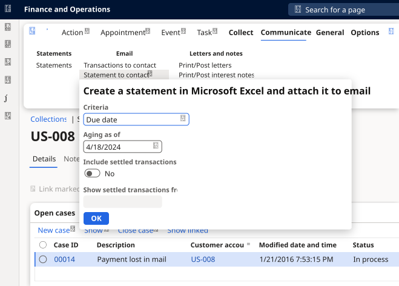

<!-- https://learn.microsoft.com/en-us/training/modules/implement-common-integration-features-finance-ops/5-emails-exchange -->
<!-- refetched: original harvest URL returned 404 -->
# Configure email (SMTP/Exchange)

Completed

* 17 minutes

The behavior of the email subsystem is influenced by a combination of administrator configuration, user configuration, and user choices.

As an administrator, on the **Email parameters** page, note the following settings on the **Configuration** tab.

The **Batch email provider** specifies which email provider will be used to send emails that are sent by processes in a batch or non-interactive manner. The Exchange provider will use the account associated with the batch process.

To specify the maximum size of a single email that can be sent via the email subsystem, set a value for the **Attachment size limit** field.

On the **Email parameters** page, note the following settings on the **SMTP settings** tab.

* In the **Outgoing mail server**, you need to specify the host name of the desired **SMTP** server. For Microsoft 365 production (including \*.onmicrosoft.com accounts) use **smtp.office365.com**. You can find this setting at outlook.office.com at **Settings > Mail > POP** and **IMAP**. However, for **Outlook/Hotmail**, use **smtp-mail.outlook.com**
* In the **SMTP port number** field, the port number should be set to **587** for secure transport.
* Specify, as needed, to send the email via the appropriate mail account by specifying credentials in the **User name** and **Password** fields. As the Microsoft 365 admin, you might have company requirements to allow some users access to another user's mailbox.

  + For example, you might want to enable an assistant to send or read email from their manager's mailbox, or give one of your users the ability to send email on behalf of another user. All users need to provide the SMTP account Send As and Send On Behalf Of permissions to enable the ability to send Simple Mail Transfer Protocol (SMTP) mail. You can configure **Send As** permissions in the Microsoft 365 Admin help center (portal.office.com/Admin) at **Users > Active users > User > Edit mailbox permissions > Send email** from this mailbox.
* The **Specify if SSL is required** field determines whether secure transport is used. Typically, this is Yes, except for internal or troubleshooting scenarios.

Email that is sent directly from the server, without user interaction, via **SMTP** is sent by the **Email distributor batch process**. That batch process must be started to process the email queue. To start the process, open the Email distributor batch pane **System administration > Periodic tasks > Email processing > Batch** and turn on Batch processing.

The default email address for each user is pulled from the **Email** field on the **Users** page **System administration > Users > Users**. An email address should be specified for each user for sign in, so this field should be populated. Users can override this default if needed.

The **Options** page can be opened by going to **Settings > User options**. The **Email provider selection** section is on the **Account** tab.

The **Email provider ID** field allows the user to select the email provider that should be used when sending an email. Selecting an option here is the equivalent of selecting **Do not ask again** in the **How would you like to send email** dialog box. Selecting the blank option **Prompt for which email provider to use** will cause the **How would you like to send email** dialog box to display when an email is going to be sent.

You can configure **Send As** and **Send On Behalf Of** permissions in the Microsoft 365 Admin help center (portal.office.com/Admin) at **Users > Active users > User > Edit mailbox permissions > Send email** from this mailbox.

To allow the user to provide an email address override for the **From** field of the email, specify an alias in the **Email** field. By default, the email alias that is associated with the user account is used as the **From** field in new emails, but this user option email address will override that.

When sending email via SMTP, the user needs to have appropriate **Send As** and **Send On Behalf Of** permissions configured in Exchange or on the SMTP server.

To test your configuration, use the **Test email** tab and specify an email provider and the recipient alias, and then select the **Send test email** button.

## Configuring and sending email

The behavior of the email subsystem is influenced by a combination of administrator configuration, user configuration, and user choices.
Both administrators and users set the behavior of the email subsystem.

* **Email parameters** page [Administrator]

  + **Configuration** tab - The **Email history** section serves two purposes. First, it provides an entry point to the **Email history** page, where administrators can review all sent emails and also any errors that prevented an email from being sent. Second, it lets you configure how long email history is maintained. By default, the last 30 days of email history are retained. You can adjust this period by changing the value of the **Number of days to retain email history** field to a non-zero number. If you set the value to 0 (zero), the default number and behavior are used.
  + The **Email throttling** feature enables non-interactive email providers (such as the batch email provider) to adhere to a per-minute sending limit. Therefore, it can help prevent some errors if the system tries to send more emails than the provider allows. Specifically, if an email can't be originally sent because the per-minute sending limit has been reached, the send attempt for the email will be deferred for up to one minute. After 10 deferrals, the system will try to send the email even if the per-minute sending limit has been reached. The sending limits for Microsoft 365 email providers are automatically set according to [Exchange Online sending limits](/en-us/office365/servicedescriptions/exchange-online-service-description/exchange-online-limits/?azure-portal=true) . Manual configuration is required for all other email providers. You can remove the per-minute sending limit from a provider by resetting the **Per-minute email sending limit** field to 0.
* **SMTP settings** tab - **Server information and Authentication**

  + [Administrator] **Email distributor batch process** - Email that is sent directly from the server, without user interaction, via SMTP is sent by the **Email distributor** batch process. That batch process must be started to process the email queue. To start the process, open the **Email distributor batch** pane (**System administration > Periodic tasks > Email processing > Batch**) and turn on **Batch processing**.

    If the Exchange provider is used, then the user account associated with the batch process (usually admin) will be the sender.
  + [Administrator] **User email** - The default send from address for each user is pulled from the **Email** field on the **Users** page (**System administration > Users > Users**). Administrators can override this send from default if needed using the **Sender email** field on the **Options** page.
  + [User] **Email provider selection section on the Options page** - The **Options** page can be opened via **Settings > User options**. The **Email provider selection** section is on the **Account** tab.
  + [User] **How would you like to send email dialog box (optional)** - When an email is going to be sent, the user will see the **How would you like to send email** dialog box that will list the available options for sending email.
  + [User] **Send email dialog box (optional)** - The **Send email** dialog box is opened to allow the user to edit the contents of the email that will be sent.

## Usage scenarios to verify if email is configured correctly

Users can see the **How would you like to send email** dialog box that will list the available options for sending email. Then, the **Send email** dialog box is opened to allow the user to edit the contents of the email that will be sent.

## Send mail via a local mail client

Email workflows that are enabled via the **SysEmail** framework can generate email messages (.eml files) that contain attachments. You can then send these messages via Microsoft Outlook or another email client.

1. In an internet browser, go to **Accounts receivable > Customers > All customers**.
2. Select **US-008 Sparrow Retail**.
3. Select **Collect > Customer balances > Collections** to open the **Collections** page.
4. Select **Communicate > Email > Statement to contact**.
5. Select **OK** to accept the default values in the dialog box.

   
6. If you're prompted for the mail option to use, clear the **Do not ask again** check box.
7. You can change this option from the **User options** page by selecting the **Use an email app, such as Outlook**, and then selecting **OK**.
8. If you're using an internet browser on your computer, open the email (.eml) file that is generated. If you're using an internet browser on the VM, copy the file to your computer and open it there.
9. Note the email address in the **To** field and the generated workbook attachment.

## Send mail via SMTP

Email workflows that are enabled via the SysEmail framework can also be created in a simple email dialog box and then sent via Simple Mail Transfer Protocol (**SMTP**).

1. In finance and operations apps, go to the **Email parameters** page.
2. Select **SMTP settings**.
3. Set the **Outgoing mail server** to the desired SMTP server, such as smtp.office365.com or smtp-mail.outlook.com.
4. Set the user name and password to an appropriate email account and password.
5. Leave **Specify if SSL is Required** turned on and leave **SMTP port number** set to **587**.
6. Select **Save**.
7. In an internet browser, go to **Accounts receivable > Customers > All customers**.
8. Select **US-008 Sparrow Retail**.
9. Go to **Collect > Customer balances > Collections** to open the **Collections** page.
10. Go to **Communicate > Email > Statement to contact**.
11. Click **OK** to accept the default values in the dialog box.
12. If you're prompted for the mail option to use, select **Use the Microsoft finance and operations apps email client**, and then select **OK**.
13. To receive the test message, change the **To address** to your email address.
14. Ensure that the account specified in the SMTP settings can **Send As** and **Send On Behalf Of** your email account. The easiest way to ensure this is to use your email account in the SMTP settings.
15. Enter a subject and body for the message.
16. Select **Send**. The message should be delivered in one to five minutes.