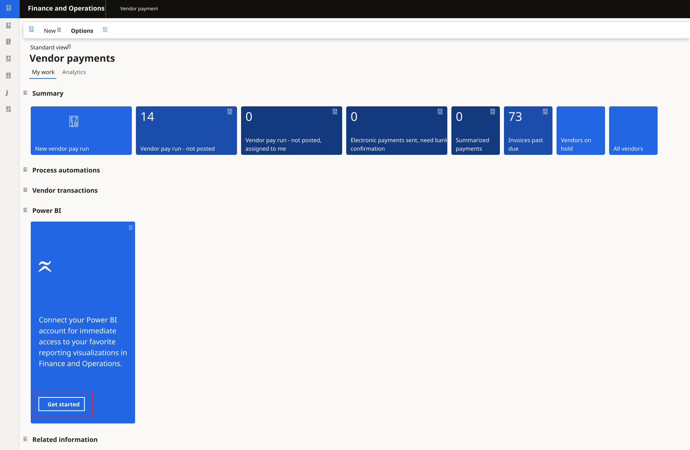

<!-- https://learn.microsoft.com/en-us/training/modules/implement-common-integration-features-finance-ops/7-power-bi -->
<!-- refetched: original harvest URL returned 404 -->
# Power BI in finance and operations

Completed

* 10 minutes

Microsoft Power BI is a suite of business analytics tools that let you analyze data and share insights. By using Power BI tools, you can explore data and quickly create rich reports and dashboards. You and your colleagues can then use the reports interactively on many devices. Finance and operations apps uses Power BI for data exploration.

Power BI comprises the Power BI Desktop app, Power BI Service, and Power BI Mobile. You import data and create reports by using the Power BI Desktop app, transforming your data into rich, interactive visualizations. You can connect to, but are not limited to, Microsoft SQL Server, Microsoft Azure SQL Database, Excel, Oracle, and MySQL.

Power BI dashboards were created with a business executive role in mind.
You can publish your reports and datasets to the Power BI Service to create and share dashboards with your colleagues. You do not have to use the Power BI Desktop app to create reports. You can sign in to Power BI.com, import data, and create reports online. The report items can then be used in dashboards.

After publishing the report to Power BI.com, you can then view and interact with reports and dashboards by using the Power BI Mobile app for cross-platform mobile devices.

You can use the natural query language to ask questions from your data through Power BI Q&A. This interactive service quickly finds the answers within your data.

Before you can add Power BI components into finance and operations apps, you need to configure finance and operations apps to connect with Power BI. To configure the workspaces for Power BI, you need to first create an application in Microsoft Entra ID, grant permissions to Power BI, and then specify Power BI configuration in finance and operations apps.

After Power BI is enabled and configured correctly, you can view the Power BI connector in workspaces, as shown in the following figure.

When you select the **Get Started** button, you can select tiles from workspaces that are available in Power BI, as shown in the following figure.

After selecting **OK**, you can view the tiles in the workspace.

You can add or remove tiles at any time, and you can drill through by selecting one of the tiles to view the detailed report in the embedded Power BI viewer.

You can open the Power BI content by selecting the **Open in Power BI** button.

Watch a demonstration of using Power BI in finance and operations in the following video.

Read more about Power BI content in finance and operations apps in
[Power BI content home page](/en-us/dynamics365/fin-ops-core/dev-itpro/analytics/power-bi-home-page?azure-portal=true&toc=%2Ffin-and-ops%2Ftoc.json).