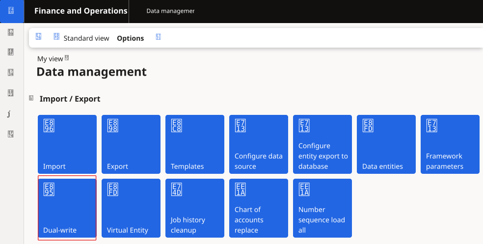

<!-- https://learn.microsoft.com/en-us/training/modules/implement-common-integration-features-finance-ops/9-common-data-serv -->
<!-- refetched: original harvest URL returned 404 -->
# Integrate data from multiple sources into Microsoft Dataverse for Apps

Completed

* 10 minutes

You can use Microsoft Dataverse to enable the flow of data between finance and operations apps and Dynamics 365 Sales by using the dual-write functionality.

For example, customer information in Sales can flow to finance and operations. You don’t have to manually move the data or use a third-party data integration tool.

To better understand using Dataverse, consider the prospect to cash scenario. The Prospect to cash solution provides direct synchronization across finance and operations apps and Sales.

You can download the **Dynamics 365, Prospect to Cash** solution from [AppSource](https://appsource.microsoft.com/?azure-portal=true)

The Prospect to cash templates that are available with the data integration feature enable the flow of data for accounts, contacts, products, sales quotations, sales orders, and sales invoices between finance and operations apps and Sales.

While data is flowing between finance and operations and Sales, you can perform sales and marketing activities in Sales, and you can handle order fulfillment by using inventory management in Dynamics 365 Supply Chain Management.

For more information about how to use data entities and prepare them for data integration using Dataverse, see [Work with data management in finance and operations apps](/en-us/training/modules/work-data-management-finance-operations/?azure-portal=true).

## Dual-write

If you want to seamlessly integrate finance and operations apps with other Dynamics 365 applications such as Dynamics 365 Sales, you can use dual-write.

With just a few clicks, you will be able to connect finance and operations with the Dataverse to send data from one application to another. Optionally, finance and operations admins can use an advanced version of the setup, in which they can customize entities and field mappings and also do source data filtering and transformation.

To set up dual-write, you will need to use the **Data management** workspace and select the **Dual-write** tile in the **Summary** section.

To see a demonstration of dual-write, watch the video.