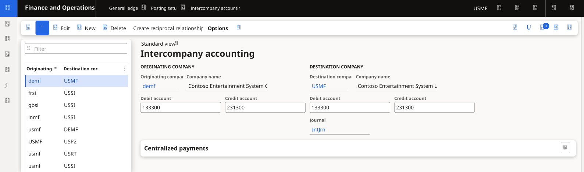

<!-- https://learn.microsoft.com/en-us/training/modules/intercompany-accounting-dyn365-finance/2-setup -->
<!-- refetched: original harvest URL returned 404 -->
# Set up intercompany accounting

Completed

* 15 minutes

When you use intercompany accounting daily journals in Finance, transactions posted in one company will cause the related transactions to post automatically in the other company.

This unit explains how to configure Intercompany accounting.

The following setup must be completed to use intercompany accounting:

1. Create the necessary main accounts in the chart of accounts.
2. Set up journal names.
3. Set up the posting relationships between companies.

Watch this video to learn how you can set up intercompany accounting in Finance:

## Create main accounts

First, you need to create the intercompany main accounts to use for the **Due to** and **Due from** accounting entries. We recommend that you use unique main accounts for each company to simplify the reconciliation and elimination of intercompany accounting entries.

The chart of accounts is a global setup, so all companies could share one chart of accounts containing unique **Due to** and **Due from** accounts for each company, or each company could have their own chart of accounts.

The accounts that were created in the chart of accounts for **Due to** and **Due from** must have the **Main account type** field set to **Balance sheet** for the posting to work correctly.

If you're using a trading partner or counterpart dimension to identify the intercompany party, you can define this dimension as a fixed dimension on the main account that is defined in intercompany accounting. The **Main accounts** page (**General ledger > Chart of accounts > Accounts > Main accounts**) is shown below.

## Set up journal names

Next, you will define a journal name. The journal names must be set up in each legal entity. For example, set the **Journal type** field to **Daily** on the **Journal names** page (**General ledger > Journal setup > Journal names**). We recommend that you use a specific journal name for intercompany accounting and to use the same journal name in all legal entities.

## Set up posting relationships between the companies

When accounts in the Chart of accounts and the journals are set up, you can set up the posting relationships between the companies.

The **Intercompany accounting** page is used to create the legal entity pairs that can transact with each other. The Intercompany accounting setup is shared, so the setup is visible from within all legal entities.

When creating a new legal entity pair, ensure that you are aware of which legal entity is defined as the originating company versus the destination company. When entering intercompany transactions, the transaction determines which legal entity is initiating or originating the transaction based on the active company.

For example, the intercompany accounting is set up for USMF (originating) and Adventure Works Cycles (destination). If a user is active in Adventure Works Cycles and enters an intercompany transaction with USMF, the transaction will not post because the intercompany accounting is only defined for USMF being the originator. If either company can originate a transaction, you will need to create a second legal entity pair for the reciprocal setup.

Select the **Debit account (Due from)** and **Credit account (Due to)** for both the originating and destination legal entity.

Define which **Journal name** will be used when the transaction is created in the destination company. The journal for the originating company is already known because it's selected by the user when creating the intercompany transaction.

Finally, select which legal entity will receive the accounting for supporting amounts, such as cash discount or realized gains/losses for centralized payments.

A reciprocal relationship can easily be set up on the **Intercompany accounting** page (**General ledger > Posting setup > Intercompany accounting**) by using the **Create reciprocal relationship** button after the first legal entity pair is created. When the reciprocal pair is created, the information for the destination company is copied to the originating company and vice versa.

The journal defined for the destination company will remain. Most organizations use the same naming convention for their journal names, so the journal name is the same. If the journal name is different, a warning will appear on the field to notify you that the journal doesn't exist, and a different journal can be selected.

Regardless of the direction of posting between company accounts, both companies must have intercompany accounts set up for the other company accounts. Any errors in the setup will cause errors in Simulate posting and Post in the journals.