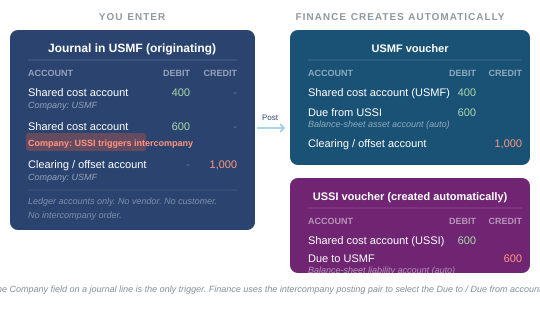

<!-- https://learn.microsoft.com/en-us/training/modules/intercompany-accounting-dyn365-finance/process-intercompany-invoices -->
# Process intercompany invoices

Completed

* 8 minutes

Intercompany finance in Dynamics 365 Finance works entirely through ledger accounts. There are no intercompany orders, intercompany vendors, or intercompany customers. Instead, Finance automatically populates **Due to** and **Due from** accounts when you post a journal that spans two legal entities.

The two types of intercompany processing differ as follows:

* **Intercompany trade** uses purchase orders, sales orders, vendor invoices, and customer invoices between companies. Intercompany vendor and customer records are required.
* **Intercompany finance** uses ledger accounts and journals. You enter one journal with lines that belong to different companies, and Finance creates the second voucher automatically. No intercompany vendor or customer record is needed.

This unit covers intercompany finance.

Note

You must configure the Due to and Due from main accounts, journal names, and company pairs before you can post intercompany journals. If the setup isn't complete, review the previous unit.

## How intercompany finance works

When you enter a journal line and set the **Company** field to a different legal entity, Finance detects the intercompany pair from your setup and automatically creates a second voucher in that entity. The two entries, one in each company, use the intercompany balance sheet accounts to keep both sets of books in balance without extra data entry.

For example, USMF incurs USD 1,000 in shared infrastructure costs and needs to allocate USD 600 to USSI. A financial analyst enters one journal in USMF with three ledger lines: two debit lines, one for each company's portion, and one credit line for the offset account. Finance generates the USSI voucher when the journal is posted.

The resulting vouchers contain the following entries:

* **USMF** records its own expense as a USD 400 debit, a USD 600 debit to the Due from USSI asset account, and a USD 1,000 credit to the offset account.
* **USSI** records a USD 600 expense debit and a USD 600 credit to the Due to USMF liability account.

## Post an intercompany journal

Use a general journal in the originating company. On each line that belongs to a different legal entity, set the **Company** field to that entity. Finance handles the intercompany entries when you post the journal.

1. In Finance, confirm that you're signed in to the originating legal entity, such as **USMF**.
2. Go to **General ledger** > **Journal entries** > **General journals**.
3. Select **New**, and then select the journal name designated for intercompany accounting in the **Name** field.
4. Select **Lines**.
5. On the first line, enter the USMF portion of the shared cost:
   1. Set **Account type** to **Ledger**.
   2. Set **Account** to the shared cost ledger account.
   3. In the **Debit** field, enter the USMF portion, such as **400**.
   4. Leave **Company** blank so that it defaults to USMF.
6. On the next line, enter the USSI portion:
   1. Set **Account type** to **Ledger**.
   2. Set **Account** to the same shared cost ledger account.
   3. In the **Debit** field, enter the USSI portion, such as **600**.
   4. In the **Company** field, select **USSI**. This selection triggers the intercompany posting.
7. On the last line, enter the offset:
   1. Set **Account type** to **Ledger**.
   2. Set **Account** to the clearing or offset account.
   3. In the **Credit** field, enter the total, such as **1000**.
   4. Leave **Company** blank because the line belongs to USMF.

Tip

Setting the **Company** field on a journal line is the only action required to trigger intercompany accounting. Finance looks up the posting pair for USMF and USSI and automatically selects the correct Due to and Due from accounts. You don't enter those accounts yourself.

1. Select **Validate** to check for errors, and then select **Post**.

After posting, Finance displays an Infolog message confirming that two vouchers were posted, one for USMF and one for USSI.

## Review the resulting vouchers

Verify that Finance created the correct ledger entries in both companies.

### Review entries in USMF

1. Go to **General ledger** > **Inquiries and reports** > **Voucher transactions**.
2. Filter by the USMF voucher number from the Infolog.
3. Confirm that the following entries are present:
   * Shared cost account: USD 400 debit for the USMF portion
   * **Due from USSI** account: USD 600 debit for the intercompany receivable
   * Offset or clearing account: USD 1,000 credit

### Review entries in USSI

1. Use the company picker to switch to **USSI**.
2. Go to **General ledger** > **Inquiries and reports** > **Voucher transactions**.
3. Filter by the USSI voucher number from the Infolog.
4. Confirm that the following entries are present:
   * Shared cost account: USD 600 debit for the USSI portion
   * **Due to USMF** account: USD 600 credit for the intercompany payable

Note

Finance uses the intercompany journal name defined in the posting pair for USSI, as the destination company, to record the automatic entries. You can view that journal in USSI under **General ledger** > **Journal entries** > **General journals**.