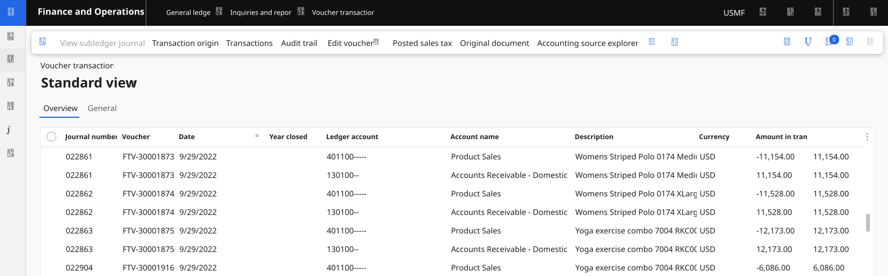

<!-- https://learn.microsoft.com/en-us/training/modules/intercompany-accounting-dyn365-finance/3-post-intercompany-journals -->
# Post intercompany journals

Completed

* 10 minutes

After the intercompany accounting is configured, you can then create and post intercompany transactions. Finance creates intercompany entries automatically by using the ledger accounts and journals that are already set up.

When making the initial entry, you don't need to use the **Intercompany daily** journal that was set up. That journal is used in the related company to record the automatic intercompany entries. You can initiate an intercompany entry from any kind of journal.

When you select a company in the **Company** accounts field, **Offset company** accounts field, or both, all companies are available. However, posting only works between companies that have intercompany posting accounts set up.

Post Intercompany transactions to **Ledger** accounts, **Customer** accounts, **Vendor** accounts, and **Bank** accounts by using the **Offset account type** field to make the selection.

The financial dimensions for the **Due to** and **Due from** main accounts default with the fixed dimensions defined on the main accounts. The financial dimensions can also default from the Account and Offset account on the journal, but only if the intercompany transaction is entered as a single-line voucher. Multi-line vouchers don't default the financial dimensions to both the originating and destination **Due to** and **Due from** ledger accounts. The financial dimensions often cannot be determined with a multi-line voucher.

When the entry posts, the vouchers immediately post in the originating and destination companies. The Infolog form that displays shows that two vouchers are posted, one for each company. This helps verify that the automatic entry posted in the other company.

The following image shows the **Voucher transactions** page in **General ledger > Inquiries and reports > Audit trail**

Watch this video to learn how you can create and post intercompany general journal entries: