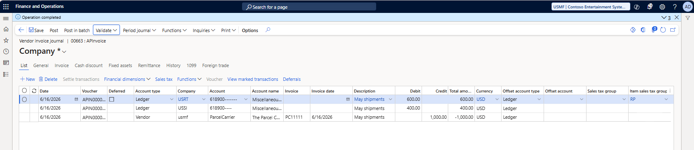
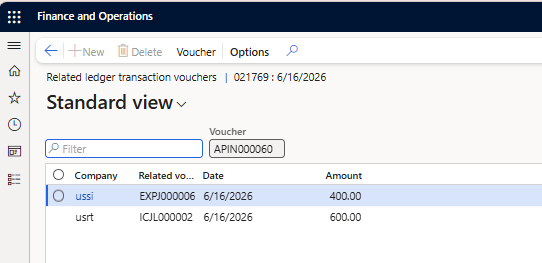

<!-- https://learn.microsoft.com/en-us/training/modules/intercompany-accounting-dyn365-finance/process-intercompany-vendor-invoices -->
# Process intercompany vendor invoices

Completed

* 8 minutes

Intercompany finance in Dynamics 365 Finance works entirely through ledger accounts. The system doesn't use intercompany orders, intercompany vendors, or intercompany customers. Instead, Finance automatically populates **Due to** and **Due from** accounts when you post a journal that spans two legal entities. This process is the same one used for intercompany general journals.

A common scenario is a supplier that provides a service used by multiple legal entities while a single legal entity pays the bill. For example, a shipping service might issue one invoice that combines shipments for multiple legal entities. The organization uses one vendor, and each shipment can appear as a separate expense line in the journal.

In this example, the parcel shipping vendor is in USMF. The vendor invoice includes two shipments in May: USD 600 for USRT and USD 400 for USSI. The expense journal lines must specify the appropriate legal entities.

The resulting vouchers contain the following entries:

* **USMF** records a USD 1,000 credit to Accounts payable.
* **USSI** records a USD 400 expense debit and a USD 400 credit to the Due to USMF liability account.
* **USRT** records a USD 600 expense debit and a USD 600 credit to the Due to USMF liability account.

## Create and post an intercompany vendor invoice journal

Use an Accounts payable invoice journal in the company that has the vendor. On each line that belongs to a different legal entity, set the **Company** field to that entity. Finance handles the intercompany entries when you post the journal.

1. In Finance, confirm that you're signed in to the vendor's legal entity, such as **USMF**.
2. Go to **Accounts payable** > **Invoices** > **Invoice journal**.
3. Select **New**, and then select the journal name designated for Accounts payable invoice journals in the **Name** field.
4. Select **Lines**.
5. On the first line, enter the vendor and the invoice amount:
   1. Set **Account type** to **Vendor**.
   2. Set **Account** to the vendor number.
   3. In the **Credit** field, enter the invoice amount, such as **1000**.
   4. Leave **Company** blank so that it defaults to USMF.
6. On the next line, enter the USSI portion:
   1. In the **Company** field, select **USSI**. This selection triggers the intercompany posting.
   2. Set **Account type** to **Ledger**.
   3. Set **Account** to the expense account used for parcel shipping.
   4. In the **Debit** field, enter the USSI portion, such as **400**.
7. On the next line, enter the USRT portion:
   1. In the **Company** field, select **USRT**. This selection triggers the intercompany posting.
   2. Set **Account type** to **Ledger**.
   3. Set **Account** to the expense account used for parcel shipping.
   4. In the **Debit** field, enter the USRT portion, such as **600**.

Tip

Set the **Company** field before you enter the ledger account. Each legal entity can have its own chart of accounts, so selecting the correct company makes the appropriate ledger accounts available.

1. Select **Validate** to check for errors, and then select **Post**.

After posting, Finance displays an Infolog message confirming that three vouchers were posted, one for USMF, one for USSI, and one for USRT.

## Review the resulting vouchers

Verify that Finance created the correct ledger entries in the originating and destination companies.

### Review entries in USMF

1. From the journal lines, select **Voucher** to view the posted voucher.
2. Confirm that the following entries are present:
   * **Due from USRT** account: USD 600 debit for the intercompany receivable
   * **Due from USSI** account: USD 400 debit for the intercompany receivable
   * Accounts payable: USD 1,000 credit for the original invoice amount

### Review related vouchers

1. On **Voucher transactions**, select **Related vouchers** on the Action Pane. The list includes one voucher in USSI and one voucher in USRT.

   
2. On **Related vouchers**, select the voucher for USSI.
3. Confirm that the following entries are present:

   * Shared cost account: USD 400 debit for the USSI portion of the cost
   * **Due to USMF** account: USD 400 credit for the intercompany payable

Note

Finance uses the intercompany journal name defined in the posting pair for USSI, as the destination company, to record the automatic entries. You can view that journal in USSI under **General ledger > Journal entries > General journals**.

The following image shows the generated intercompany voucher in USSI.

