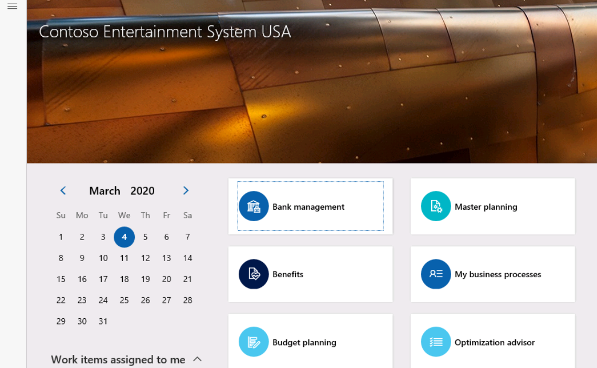
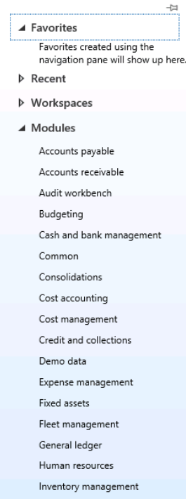
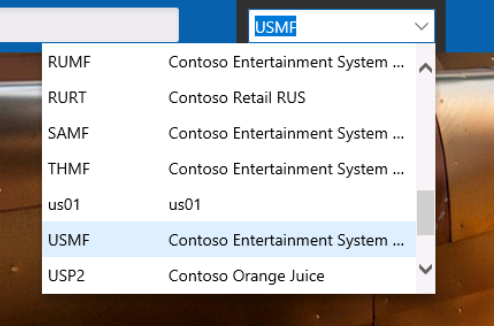

<!-- https://learn.microsoft.com/en-us/training/modules/introduce-configure-personalization-dynamics-365-finance-operations-apps/set-up-your-environment -->
# Set up your environment

Completed

* 2 minutes

#### Log in

Dynamics 365 applications are browser-based, for maximum portability and
adaptability to any device. You log into the system by opening a browser
(supported browsers are listed here: [System requirements for cloud deployments](/en-us/dynamics365/fin-ops-core/dev-itpro/get-started/system-requirements#supported-web-browsers)
) and log in using your Microsoft Entra ID.

#### Navigation pane

Notice the navigation pane on the left-hand side. It provides access to favorites, recent
pages, workspaces, and modules.

* You may add a form or report on a menu to your favorites, simply by hovering
  your mouse near the menu item, and selecting the star that appears to the
  right of the name. These will be listed under **Favorites** in the navigation pane.
* The **Recent** section will display the menu items you have recently
  selected.
* **Workspaces** are aligned to roles and streamline functionality, with a lot
  of visual KPIs and easy-to-select popular items.
* **Modules** provides the full list of modules. Selecting a module opens the
  right side of the navigation pane, where you can go to the pages in that
  module.

#### Legal entity

Notice that typically you log into company DAT. You can easily change the legal entity
that you're in. Select the **DAT** field and select the
legal entity you want from the drop-down that is offered.

