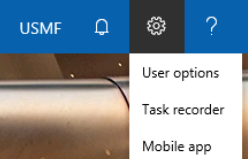
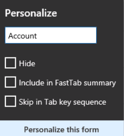
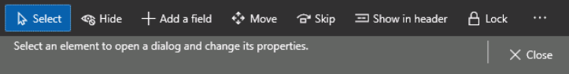

<!-- https://learn.microsoft.com/en-us/training/modules/introduce-configure-personalization-dynamics-365-finance-operations-apps/explore-personalization-functionality -->
# Explore personalization functionality

Completed

* 3 minutes

In Dynamics 365, the word *personalization* is used to indicate noncode changes
to the system, especially in the user interface. It applies especially to
individual users. The word *customization* typically indicates code written by a
developer, usually for all users. This isn't a hard and fast rule, and can be
set otherwise. For example, personalizations may be applied to multiple users
(for example, all users in a particular role).

#### Changing your default company

Earlier, we discussed changing the company we're currently logged into. What if
we want to change our default to that company, so that we don’t need to change
it each time we log in?

You can also change your default company: Select the gear icon in the top right
of your screen, and choose User options.

In the Options screen, select the Preferences tab and change the Startup Company.

#### User options form

In this form, you have many options for customizing the user experience:

* Visual

  + Color theme
  + Size
* Preferences

  + Startup

    - Company
    - Default view/edit mode
    - Initial page (typically the default dashboard or Immersive Home)
  + Language and country/region preferences

    - Language
    - Time zone
    - Date, time, and number format
    - Country/region
  + Miscellaneous

    - Document handling enabled Y/N
    - URL Manipulations: Automatically update query parameter Y/N
  + Accessibility

    - Enhanced tab sequence Y/N
    - Show tooltips on focus Y/N
  + Task management

    - Show task list on default dashboard Y/N
* Account

  + Account

    - User ID (display only, no edit)
    - Network domain (display only, no edit)
    - Name
    - Telemetry ID (display only, no edit)
    - Alias (display only, no edit)
  + Email provider selection

    - Email provider ID
    - Email – used in notifications and document handling
  + Electronic signature

    - Signature enabled Y/N
    - Valid certificate Y/N
    - There are also buttons to designate an approver and get a
      certificate
* Workflow

  + Notifications

    - Send notifications in email Y/N
    - Line item workflow notification type (individual or grouped
      notifications)
    - Alternate email
    - Send notifications to Action Center Y/N
  + Delegation

    - Here, delegates can be added and removed

From the **User options** page, you can also review what you've changed. Select
**Usage data** on the Action Pane to view and delete your usage data. On the
**Personalization** tab, you can view and manage the personal changes that you
made to pages, and reset feature callouts so that you're alerted again about
previously encountered features.

#### Saved views

Saved views let you save named sets of personalizations and filters for a page, so you can quickly switch between them. A saved view captures your personalization of a form together with the filtering and sorting of the form's data source. You can publish views to specific security roles, making it easy to share optimized page layouts across your organization.

#### Form personalization

Form personalization is launched from one of two places:

* From any form in the user interface: Right click in a field or grid and select *Personalize*.

  

  The resulting property window lets you:

  + Change the element's label
  + Hide (the field)
  + Include in FastTab summary
  + Skip in Tab key sequence
  + Require (designate a field as required for data entry)
  + Lock (mark a field as noneditable)
  + Personalize this page

  The last option gives you many more options, including one to add fields to the
  page.

  

  Tip

  You can also open the **Personalization** toolbar by pressing **Ctrl+Shift+P**, or by selecting the **Settings** button (gear icon) on the navigation bar and then selecting **Personalize**.

  Additional toolbar tools include **Clear** (to reset the page to its default state), **Import** (to load a personalization from a file), **Export** (to save personalizations to a file for sharing with other users), and **Add an app** (to embed a Power Apps or third-party app into the page).
* From the Options tab (you may need to select the ellipsis … to see it) select Personalize this page

  

  