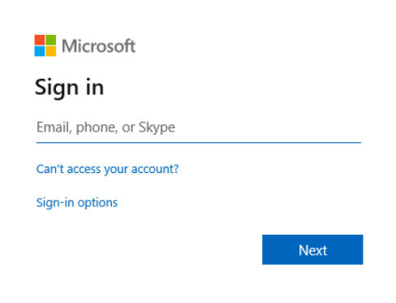
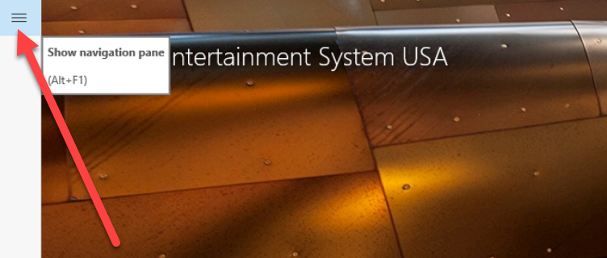

<!-- https://learn.microsoft.com/en-us/training/modules/introduce-configure-personalization-dynamics-365-finance-operations-apps/exercise-favorite-menu-items -->
<!-- refetched: original harvest URL returned 404 -->
# Exercise - Favorite some menu items

Completed

* 2 minutes

1. Open your browser
2. Log into your environment

   
3. On the left side, select the navigation pane icons

   
4. Expand the Favorites and see what is available

   
5. Under Modules, select Accounts receivable
6. Open Customers, hover over All customers, and select the star to Add to Favorites

   
7. Return to the Favorites menu and see All customers listed

   
8. Repeat for any other menu items (forms, reports, jobs) that you will want to come back to frequently