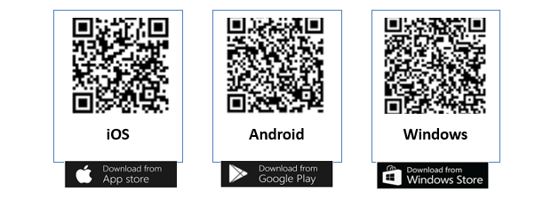

<!-- https://learn.microsoft.com/en-us/training/modules/mobile-experiences-finance-operations/access-mobile-experiences -->
# Access mobile experiences

Completed

* 10 minutes

To access any Microsoft Power Platform app (canvas and model-driven), you can run and use the app on Power Apps mobile.

After you've downloaded the mobile app, sign in with your Microsoft Entra ID credentials. If your organization uses the Microsoft Authenticator app, the system prompts you to authenticate and approve the sign-in on your device. After you've signed in, the apps that you have access to display on the app home page.

From the home page, you can tap the app that you want to launch and use. Additionally, you can tap the information icon to view the Power Apps application details. The following image shows the Power Apps home page after a user has signed in. The user has access to three mobile experiences.

The following image shows the **Contoso Expense Mobile App**.

## Use custom branding with mobile experiences

You can use the wrap feature in Power Apps to wrap your canvas app as a custom-branded Android or iOS app. This feature allows for native distribution to mobile users. By using this feature, you can distribute a wrapped mobile app to users who have commonly used app platforms.

For more information, see [Overview of wrap](/en-us/power-apps/maker/common/wrap/overview?azure-portal=true#understand-wrap-process).