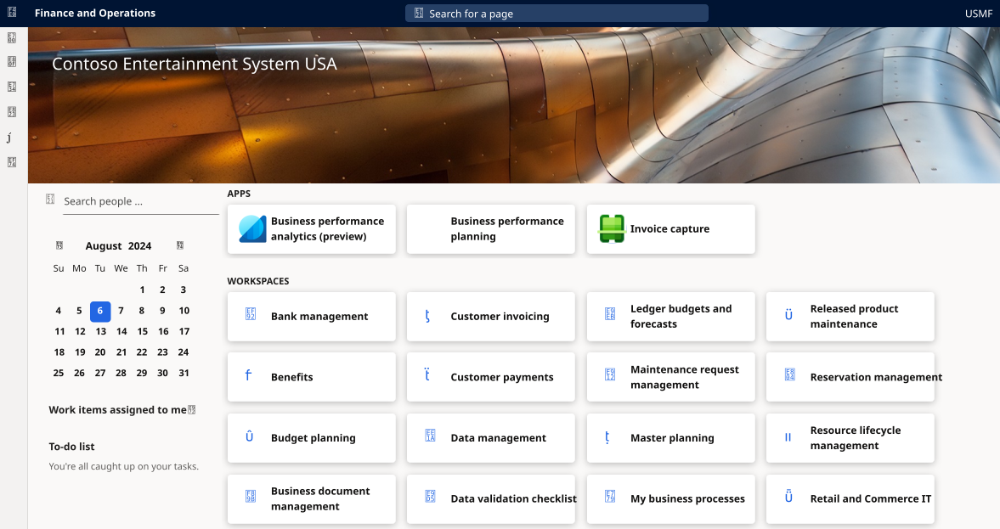
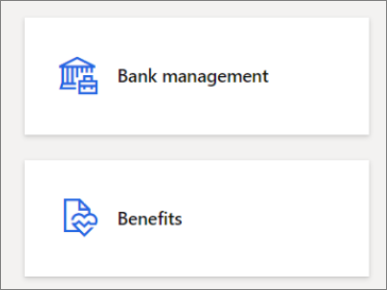
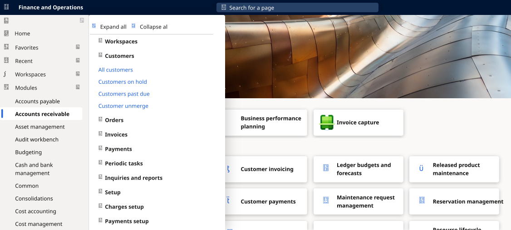
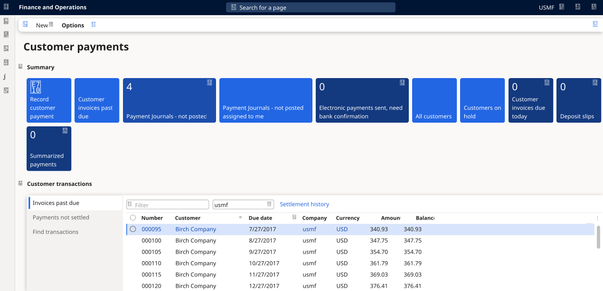

<!-- https://learn.microsoft.com/en-us/training/modules/navigate-finance-operations/2-navigation-elements -->
# Navigation elements

Completed

* 6 minutes

The dashboard is the first page that you see in finance and operations apps. It contains tiles that show various information. You can return to the dashboard at any time by selecting finance and operations apps on the navigation bar at the top of the frame.

The dashboard consists primarily of a large section of workspace tiles.

## Tiles

A tile is a rectangular button that behaves like a menu item button. It is used to navigate to, or open pages. Tiles can also display relevant data, such as counts or key performance indicators (KPIs). A tile can include images that provide you with more visual context.

The screenshot shows the **Bank management**, and **Benefits** tiles.

## Overview

Here is a list of the most important navigation elements that you should understand to work with finance and operations apps.

* **Action Pane** - The bar beneath the navigation bar. Here, you can select tabs to change records shown in the page. You can edit and save the records here.
* **FactBox** - You can see information and follow the activities of certain records in this pane.
* **FactBox pane** Here, you can scroll through different aspects of a record to view in the FactBox.
* **Filter pane** - On some pages, you can select **Show filters** to open this pane. It allows you to narrow the results visible to you on the page.
* **Navigation bar** - The bar at the top of the interface. It contains the **Dynamics 365 portal**, **Search**, **company picker**, **Action center**, **Settings**, **Help & Support**, and the user profile.
* **Navigation list** - On some pages, you can scroll through this pane to find a specific record. When selected, the details of the record appear in the page.
* **Navigation pane** - The left-most pane. From here, you can find any page in the product.
* **Page** - The central focus of the interface. Selections made on the other UI components affect what records are shown here.
* **Pane** - The right-most pane. This opens in some cases when aspects of a record need to be changed and saved.
* **Tab** - When referring to the Action Pane, it's a menu of options that appears when you select a given option in the Action Pane.

For more information, see [User interface elements](/en-us/dynamics365/fin-ops-core/fin-ops/get-started/user-interface-elements/?azure-portal=true).

## Navigation pane

The navigation pane provides access to workspaces, main menu elements, recently opened pages, and user-defined favorites. You can open the navigation pane by selecting the **Show navigation pane** button under the navigation bar.

The navigation pane consists of four collapsible sections.

* **Favorites** - This section provides quick access to the list of pages the user has explicitly marked as a favorite. Marking a page as a favorite is accomplished by selecting the star icon next to the page in the navigation pane. This can be helpful for areas of the system that are used frequently, or, conversely, areas of the system that are not used frequently but could benefit from being easily accessible when the need arises.
* **Recent** - This section is a list that is auto populated with links to the areas in the system that have been viewed most recently. This can be helpful for reference purposes, and easily switching back and forth between separate areas of the system.
* **Workspaces** - This is the set of workspaces a user has access to.
* **Modules** - This section provides the full list of modules. Selecting a module opens the right side of the navigation pane, where you can navigate to a specific page in that module.

## Workspaces

Workspaces are activity-oriented pages that are designed to increase your productivity by providing information that answers your most pressing activity-related questions. This is where you store your more frequent tasks.

Access to the various workspaces depends on the roles that users have in the organization.

To navigate to a workspace, you can select a tile on the dashboard, select a link in the navigation pane, or find the workspace using the navigation search feature.

Here is an image of the **Customer payments** workspace.

Workspaces contains sections of content that are relevant to the task for which the workspace is intended.

The first section is usually a set of tiles that you can select to begin new tasks or access lists of items. The second section contains a set of relevant lists for the activity. The last section contains several links to pages that are important but not frequently used for this activity.

In between the list and links section are a few optional sections that might contain charts and graphs. One important distinction of workspaces is that they do not have a data source.

If the content requires a data source, it can be updated to include that.

As with all pages in the application, you can navigate to the previous page using the back arrow in the left-most corner of the Action Pane.