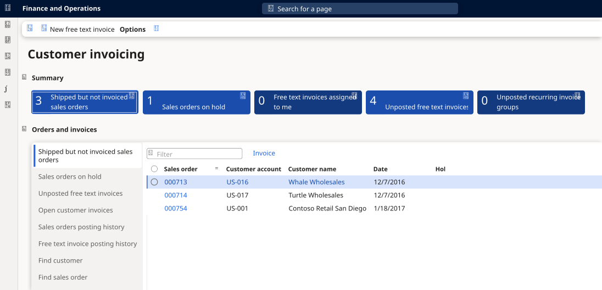

<!-- https://learn.microsoft.com/en-us/training/modules/navigate-finance-operations/3-workspaces-driving-productivity -->
# See how workspaces drive productivity

Completed

* 8 minutes

A workspace is a one stop-shop for specific activities. Here are some of the ways a workspace can help drive productivity:

* **360-degree view of activities** - No need to navigate to multiple lists.
* **Answers specific questions** - Questions such as:
  + Are there urgent cases that need to be attended
  + How difficult will my workload be?
  + Are cases easy or difficult to solve?
* **Provides insight** - Compare multiple sources of data. Provide a big picture view that might be difficult to achieve when only looking at lists in specific modules.
* **Navigates by data** - Less time spent filtering to find results
* **Direct access to tasks** - Tasks can be performed directly from the workspace.

Watch this video to see how to use the features of sales and marketing by using a workspace in finance and operations apps.

Let’s take a look at some key areas of the **Customer invoicing** workspace.

**Summary** - This section contains tiles for various types of orders and invoices. Each tile will also display how many orders belong to each category. You can click a tile to open a relating list page. For example, the **Shipped but not invoiced sales orders** tile shows there are three orders that need invoices. You can click the tile to see the three orders.

**Filter** - The **Filter** search box allows you to easily find orders and invoices.

**Orders and invoices** - Various tabs provide access to various sections of the workbench. Each tab contains any sales orders or invoices relating to the tab. The first tab includes shipped but not invoiced sales orders.

**Links** - The **Links** section is broken into two sections: links relating to invoices and links relating to reports.

**New free text invoice** - New free text invoices can be created directly on the **Customer invoicing** workspace page by clicking the **New free text invoice** button on the Action Pane.