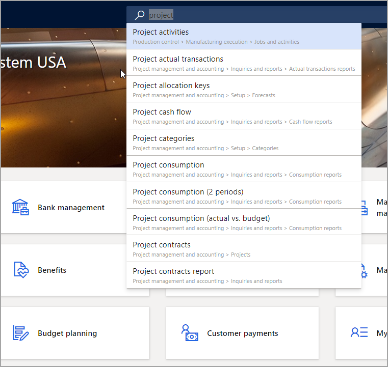
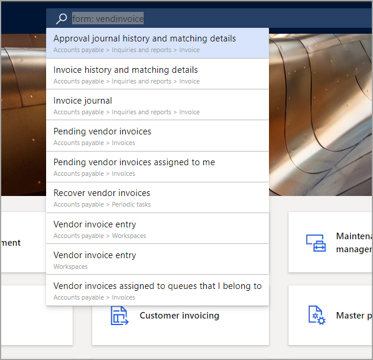

<!-- https://learn.microsoft.com/en-us/training/modules/navigate-finance-operations/5-searching -->
# Search in finance and operations apps

Completed

* 5 minutes

The search mechanism is used for finding and navigating to pages and workspaces that appear in the navigation pane and on the dashboard. The search keywords are matched not only to the caption of the navigation elements but also to the corresponding path.

For example, a search on the keywords returns a list of navigation elements that match those keywords.

There are two specific ways to search:

* **Keywords** - Using the search feature, you can enter keywords to find a specific page. The results in the list will include complete and partial matches, as well as the manual navigation path for the page.
* **Form names** - Technical users who are looking for a specific form name in the system can use the search feature by entering “form:” followed by the actual form name, such as “vendInvoice” to find specific pages in the system that use that form. The list will populate with pages that use the form specified.

There are two important things to consider when using search:

* The search feature is used to locate pages in the system, not specific data, or actions.
* The results will also include partial hits for the navigation path. For instance, searching the word “receivable” will include a larger number of hits than “all purchase orders” because the word “receivable” is included in the navigation path for many pages.

To use the search feature, select the **Search** icon to display the **Search** box. You can then type one or more words in the box. finance and operations apps instantly searches for relevant pages in the application that match the words that you entered.

For example, you could type “l e” as the input, and then the system displays results that match that input. In this case, it will show all pages that start with letter “l” and then letter “e”.

In the screenshot below, you will see the results of a search using the word "project".

The search results list displays the page title as well as the navigation path. This shows the location of the page in the application. It also helps you differentiate between two or more similar pages in the results.

## Quickly navigate to a page

The navigation search feature also serves as a great way for you to quickly navigate to a page.

For example, if you are an accounts payable clerk who frequently uses the **Payment journal** page, you could enter "payment journal" in the **Search** box. Because the input is an exact match for the page title, the page is listed at the top of the search results, and you can quickly navigate to it.

## Administration and security

From an administration and security perspective, the navigation search functionality only surfaces two types of results:

* Pages that are enabled in the current configuration (via configuration keys).
* Pages that the user has access to, based on the user's role.

The list of search results is limited to 10 items. If you do not find what you're looking for in the results, you should try refining or updating the input.

## Developers can benefit from search

The navigation search functionality also includes a feature for power users and developers; the ability to quickly navigate to a page based on the technical form name.

Many users are so familiar with finance and operations apps that they know the exact form names they work with.

If you are one of these users, you can enter "form:" followed by the name of the form you are looking for. For example, if you enter "form: vendinvoice", the search results will show all pages where the form name starts with "vendinvoice".

## Action search

Pages in finance and operations apps primarily expose commands on Action Panes, both the standard Action Pane that appears at the top of a page and the toolbars that appear in various sections of the page.

The action search feature lets you quickly search for and run a button from any visible Action Pane. Action search will help you find and run actions on a page.

To use the action search feature, follow these steps.

1. On the Action Pane, select the **Action search** field. (The **Action search** field contains a magnifying glass icon.)
2. Type all or part of the name of the button that you want to run. You can also search by using words from the button's "path." Typically, a button will appear near the top of the results list after you've typed two to four characters.
3. Find and run the button in the results list (by using your mouse or keyboard).

After the button is run, the focus is returned to your last position on the page, so that you can continue to work.
You can also start action search by pressing **Ctrl+'** or **Alt+Q**. Press the keyboard shortcut again to return the focus to your last position on the page.