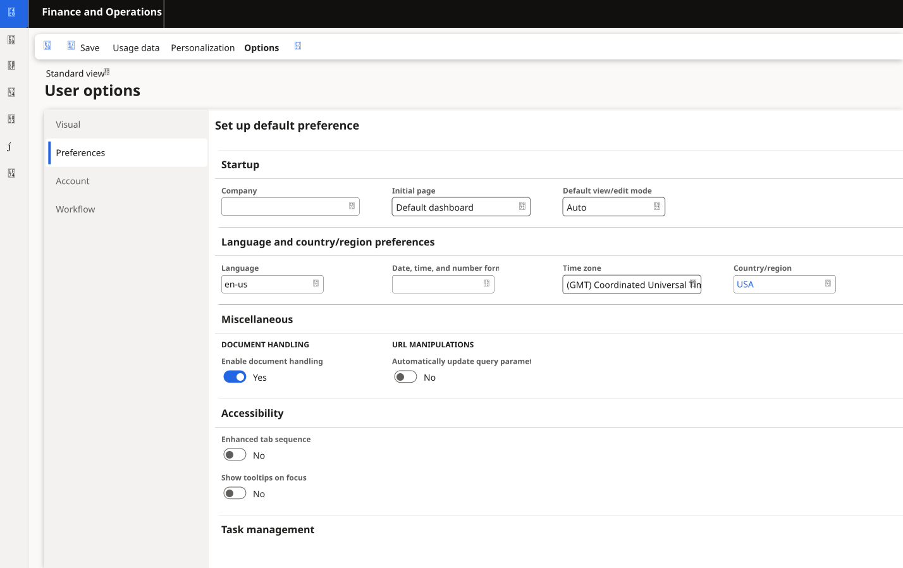
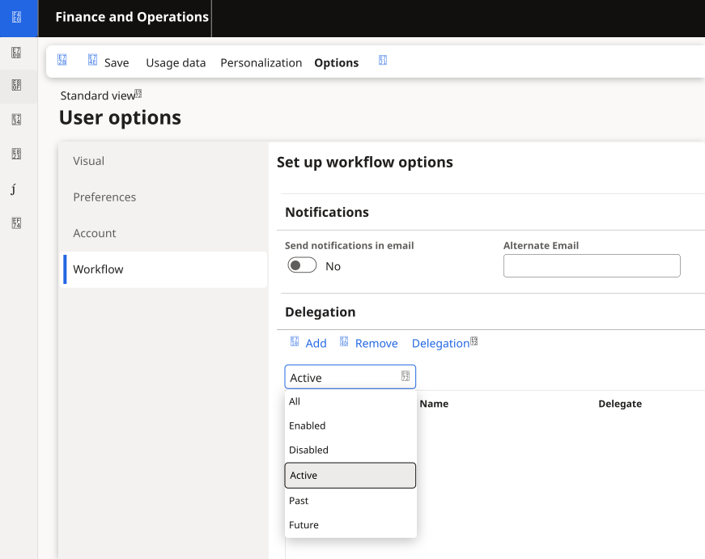
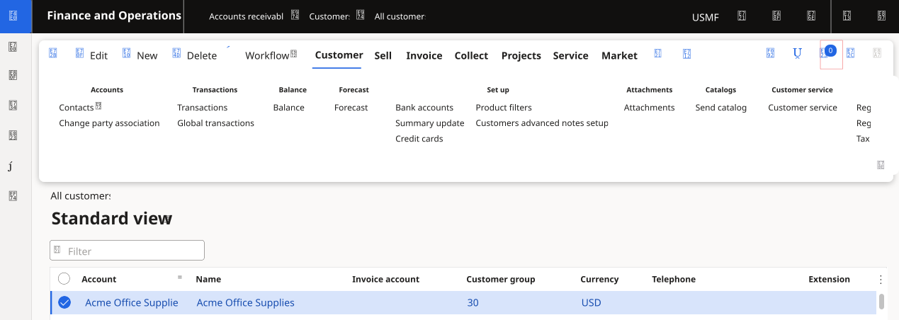

<!-- https://learn.microsoft.com/en-us/training/modules/personalize-finance-operations/3-user-options -->
<!-- refetched: original harvest URL returned 404 -->
# Apply user options

Completed

* 13 minutes

Finance and operations apps offers some various color themes and element sizes to create an aesthetically pleasing interface. You can use the **User options** page to control basic features and behavior of your environment that are specific to you as a user. The system administrator can control these user options from the **Users** page in the **System administration** module.

Watch this video to learn how to work with user options in finance and operations apps.

## Visual options

On the Navigation bar, you'll find a gear wheel icon that accesses the **Settings** menu. Opening the **Settings** menu will show several choices. Selecting **User options** will open the **User options** page. There you'll find four option tabs, one of which is named **Visual**. You can personalize many options such as the color theme and time zone for each user.

With the **Visual** tab, you can select a color theme to apply to the system and determine whether you'd like larger or smaller element sizes on your pages.

## Preferences

On the **Preferences** tab on the **User options** page, you have a variety of options that you can select. You can select default values that are used every time that you open finance and operations apps.

These values include the company, initial page, and default view/edit mode. The view/edit mode determines whether a page is locked for viewing or opened for editing every time that you open it.

The **Preferences** tab also includes options for the language, time zone, and date, time, and number format. This tab also includes several miscellaneous preferences that vary from release to release.

* **Company** - This allows you to define which company you sign in to when you access finance and operations apps. You can always change the company that you are connected to using the Navigation bar.
* **Initial page** - There are a variety of options you can select here to define which page will open when you first launch finance and operations apps.
  + **Default dashboard** - This refers to the home page that you have seen in most demonstrations of finance and operations apps.
  + **System administration** - This option will default the user into the System administration workspace. This option is useful for system administrators.
  + **Essentials dashboard** - This option defaults the user to the Retail essentials workspace, which has a different layout that is targeted and designed for back-office retail workers.
  + **Employee self-service dashboard** - This option is designed for the typical worker or manager who only uses a few areas of the system on a regular basis.
  + **Prospective vendor registration** - This page is designed for prospective vendors to complete their application and onboarding process. This option is not typically selected for a regular user.
* **Default view**/**edit mode** - This option allows you to select between **Auto**, **View**, and **Edit**. The default option is **Auto**. When you change this option to **View**, all forms by default will open in **View** only mode. This is useful for users who do not typically make changes to the system, such as system administrators. The users must then click the **Edit** button to make any changes. The **Edit** option is used to force all pages to open in edit mode so that users can make modifications without having to click the Edit button in the Action Pane. This is useful for users who always modify data on every page that they open. You can control this setting based on pages, which overrides the option you select here.
* **Language and country**/**region preferences** - On this FastTab, you can control settings for language, date, time and number format, time zone, and country/region the users will operate with. Changing these selections will only change how the user interface appears to the selected user, not how the data is stored in the database.
* **Document handling enabled** - This option determines whether the paper clip icon with document handling is activated for the selected user. When the option is enabled, you can see a number on the paper clip icon that indicates the number of attachments for a selected document. This can have a performance impact if attachments are used heavily.
* **Automatically update query parameter** - When this option is turned on, the system will automatically save any filters that you have created on a form when adding the URL to your favorites or sharing the URL from the Options tab on the pane.
* **Enhanced tab sequence** - In everyday system use, not every field is required to perform typical tasks. Therefore, by default, the tab sequence is optimized. Tab stops are set only on those fields that are essential for typical scenarios. However, you might find that some fields that you often use to perform tasks aren't included in the default tab sequence. In this case, if you use Windows Narrator, you can use Windows Narrator's keyboard actions to access those fields and inspect their content. Alternatively, you can enable the **Enhanced tab sequence** option on the **User options** page, which makes all editable and read-only fields part of the tab sequence. You can then use page personalization to create a custom tab sequence and omit fields from the tab sequence.

## Set up Account Information

The **Account** tab on the **User options** page contains a variety of options that control account functions, such as which account in the Active Directory it’s linked to, and how emailing and electronic signatures are controlled for user accounts. These settings are typically controlled by your administrator. You can also adjust your user name and other account-related options on this page.

## Workflow

The **Workflow** tab on the **User options** page allows you to control how notifications for workflow will be delivered. You can also use the **Delegation** FastTab to control exactly which workflows and time periods you want to use to delegate your workflow tasks and approvals.

## Document handling

You may need to add attachments to a record in the system, this might include an invoice from a vendor, customer receipts, product details for a purchase requisition, or expense receipts, just as some examples. You can easily add attachments to records that allow document handling in finance and operations apps. You can also view attachments from all tables on the pages that are related to the active record.

To add an attachment to a record, follow these steps;

1. Select the record you wish to attach a document to (such as a customer, invoice, or vendor).
2. Select the paperclip icon on the top right corner of the page.

   
3. On the **Attachment for Customers** page, select **New** in the Action Pane, then select the type of document you are attaching.
4. Browse to the file you wish to attach. The file will upload and be attached to the record.
5. You can add additional notes and details to the attachment on the page.