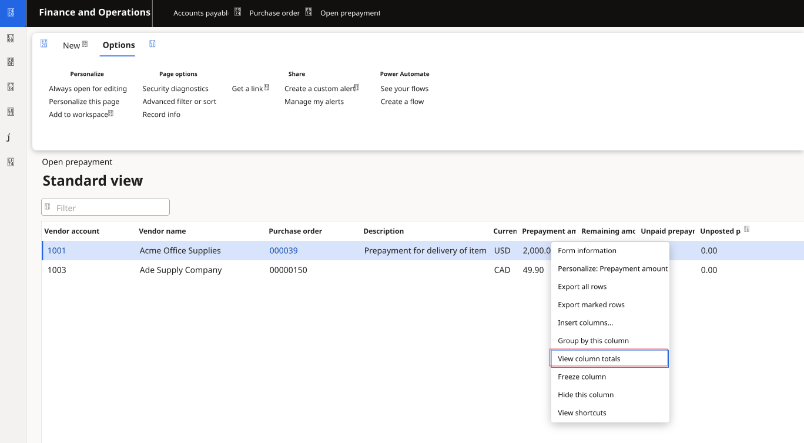
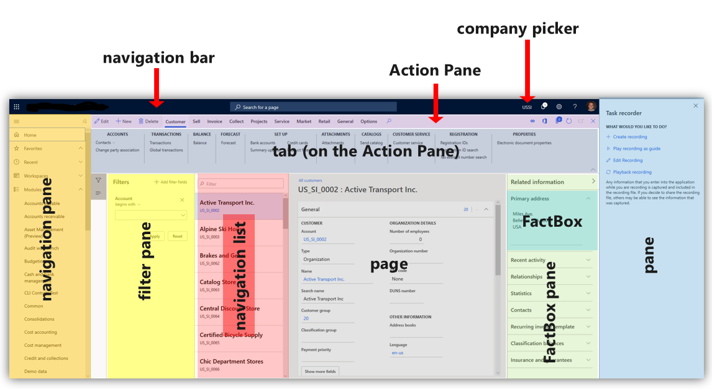
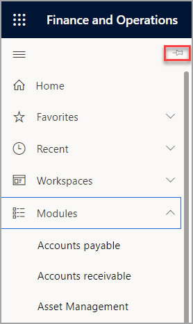

<!-- https://learn.microsoft.com/en-us/training/modules/personalize-finance-operations/4-implicit -->
<!-- refetched: original harvest URL returned 404 -->
# Implicit personalization

Completed

* 5 minutes

Finance and operations apps keeps track of the width of grid columns if you adjust them, and the expanded or collapsed state of FastTabs. This type of personalization is called implicit personalization.
For example, if you adjust the column width within a grid, or expand or collapse FastTabs and FactBoxes, it would be considered implicit personalization.

When the same grid is opened again, finance and operations apps retrieves the personalization done on the columns, FastTabs, and FactBoxes based on the last interaction with the grid.

Consider the following controls when creating an implicit personalization:

* **Grid columns** - You can adjust the width of a column in a grid by selecting the sizing bar to the left or right of the column header, and then sliding it left or right until the column is the desired width. Finance and operations apps stores the width that you set for a column. It then resizes the column to that width every time that you open the page that includes that grid.
* **Freezing columns** – When working with grid columns, you might come across a column with information that is important to you, and that you would like to continue to see as you move throughout a grid. You can freeze a column into place to be able to see that information at all times, as your move throughout the grid of information.

  + To freeze a column, right-click on its header and select **Freeze column** from the menu. When you complete this step for the first time, the selected column becomes the first column and no longer scrolls out of view.
  + To unfreeze a column, right-click in the frozen column's header, and then select **Unfreeze column**.
    
* **QuickFilters** - A *QuickFilter* appears above many grids. The QuickFilter lets you filter the grid based on a column you select. Finance and operations apps stores the column that you filtered on.
* **Column header filters** - When you filter a grid by using the column header filters, you can change the filter operator as needed to find the data that you want. For example, you can change the operator from **begins with** to **is exactly**. Every time that you use a column header filter and you modify the filter operator, finance and operations apps stores the change.
* **Pinned marking column** - The marking column in the grid is pinned to the left, and is always visible and available regardless of its width.
* **Mathematical formulas** - You can enter mathematical formulas into numeric cells in a grid. For example, you can enter **=15\*4** and then press the **Tab** key to move out of the field. The system evaluates the expression and saves a value of **60** for the field.

  Note

  To make the system recognize a value as an expression, start the value with an equal sign (=). For more information about the supported operators and syntax, see [Supported math symbols](http://bugwheels94.github.io/math-expression-evaluator/#supported-maths-symbols/?azure-portal=true).
* **Calculating totals and aggregates** - You can see totals for numeric columns in tabular grids. For example, financial users can view totals for a filtered set of transactions for a specific customer. The totals are shown in the footer section at the bottom of the grid. Right-click the column and select **View column totals**, as shown in the screenshot below. You can select to calculate the sum, minimum, maximum, and average value. To do this, you must have the **Extended grid aggregation capabilities** feature enabled in Feature management. Keep in mind, if grouping has been performed within the grid, the chosen aggregate function for that column will be displayed per group.

  

  Note

  The entire dataset is required for this functionality, so it might take time to calculate totals for large datasets.
* **Fast data entry** - Use this feature to enter data in a grid ahead of the server. It minimizes users' need to wait for the server to validate one row in the grid before they move to another row. Users can also paste copied tables from Microsoft Excel directly into grids in the system. To do this, select and copy the rows in your Microsoft Excel file that you want to copy into the system. Navigate to the grid in the system that you want to paste the rows into. Scroll to the last line and select **New**. Paste the rows and select **Save** in the pop-up dialog to save your changes.
* **SizeToAvailable width columns** - Developers can set WidthMode=SizeToAvailable on columns inside grids. These columns start with the same width as the **SizeToContent** width mode setting, but stretch to use any extra available width inside the grid. If multiple columns are set to **SizeToAvailable**, they can share any extra available space in the grid.
* **Reorder columns** - You can reorder columns by dragging them. Hover the mouse pointer over the column header and then drag the gripper control that appears on the column's left side.

For more information, see [Grid capabilities](/en-us/dynamics365/fin-ops-core/fin-ops/get-started/grid-capabilities/?azure-portal=true).

## User interface (UI) elements

Below are some of the elements that make up the interface:

* **FastTab** - Some pages have expandable sections that are known as *FastTabs*. Finance and operations apps stores information about the FastTabs that you've expanded and collapsed. Then, every time that you return to the page, the same FastTabs will be either expanded or collapsed, based on your last interaction with the page. In some cases, you can help improve system performance by collapsing a FastTab, because finance and operations apps doesn't have to retrieve the information for that FastTab until the FastTab is expanded.
* **FactBox** - Some pages have a section that is known as a *FactBox pane*. This pane contains read-only information that is related to the current subject of the page. Each section in the FactBox pane is known as a *FactBox*. You can hide or show the whole FactBox pane, and you can also expand or collapse single FactBoxes. Finance and operations apps stores your preferences. Then, every time that you return to the page, the state of the FactBox pane and the individual FactBoxes will be restored, based on your last interaction with the page. In some cases, you can help improve system performance by collapsing a FactBox, because finance and operations apps doesn't have to retrieve the information for that FactBox until the FactBox is expanded.
* **Action Pane** - An *Action Pane* appears near the top of most pages. The Action Pane contains buttons for many of the actions that you can perform on the current page. These buttons are often organized on tabs. You can pin open the entire Action Pane, or you can have it collapsed by default. Then, the next time that you open the page, finance and operations apps will restore the pinned state of the Action Pane. If the Action Pane is pinned open, finance and operations apps will also show the tab of actions you last used.
* **Navigation pane** - You can open the *Navigation pane* by selecting the **Show navigation pane** button in the left pane of any page. You can pin the Navigation pane open, or you can keep it collapsed by default. After you pin the Navigation pane open, finance and operations apps will keep it open until you collapse it.

  