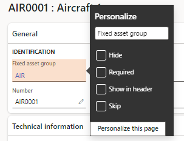

<!-- https://learn.microsoft.com/en-us/training/modules/personalize-finance-operations/5-explicit -->
<!-- refetched: original harvest URL returned 404 -->
# Explicit personalization

Completed

* 5 minutes

You can modify the appearance of a page by changing the way an element appears or acts on that page, often through an interactive personalization mode. This personalization is called *explicit personalization*. Explicit personalization is personalization that you make explicitly, with the intention of changing the appearance or behavior of an element or page.

You can explicitly personalize an element in the following ways:

* Change the label of a field.
* Hide a field.
* Include field information in the FastTab summary.
* Skip a field when you press Tab.
* Mark a filter as not editable.

Depending on the control that you want to personalize explicitly, the options can vary.

For example, you might add, hide, or reorder elements on the page.

In finance and operations apps, you can tailor the way that your information is ordered and interacted with. You can also specify that some information should be hidden. These capabilities are key to a personal and productive experience and are examples of explicit personalization.

## Shortcut menu options

Shortcut menus, also known as a right-click menu or context menu, provide a few ways to explicitly change a page to better suit your requirements or the requirements of your company.
Some of the most typical and important changes that can be made to a page are available directly as options on a shortcut menu. For example, if you want to add or hide columns in a grid, just right-click a grid column header, and then select **Add columns** or **Hide this column**.

## Control property window

Also, the most basic types of explicit personalization are available by right clicking an element and then selecting **Personalize**.

You can use the property window to personalize an element in the following ways:

* Change the element's label.
* Hide the element so that it isn't shown on the page. The data in the field isn't deleted or modified. The information just doesn't appear on the page any longer.
* Include the information in the FastTab summary section (if the element is on a FastTab).
* Skip the field when you press Tab to move among the fields on the page.
* Prevent data in the field (for any record) from being edited.

The property window might include other personalization capabilities, depending on the element. For example, the property window for a tile might let you promote that tile to a dashboard, and the property window for a dashboard might let you create a new workspace on that dashboard.