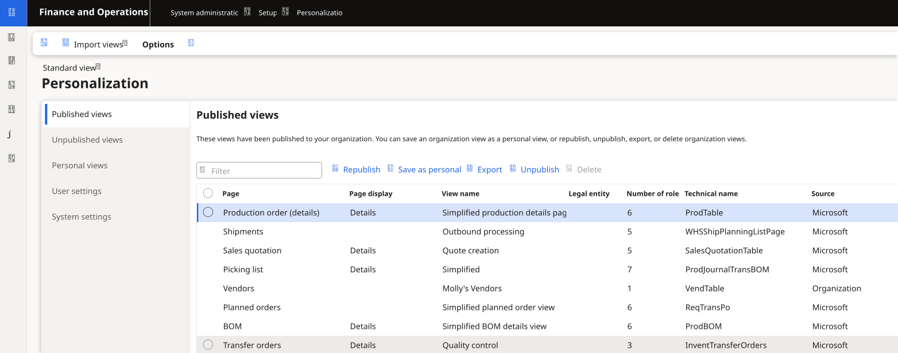

<!-- https://learn.microsoft.com/en-us/training/modules/personalize-finance-operations/11-admin-personalize -->
<!-- refetched: original harvest URL returned 404 -->
# Administer personalization

Completed

* 5 minutes

The **Personalization** page is the hub for managing personalization at an organizational level by system administrators and saved view administrators. After a user personalizes a page, saves and publishes the view, Administrators can manage views for the system via the **Personalization** page.

For example, the Accounts Payable director meets with their team weekly to be updated on any vendors with a balance 90 days or more past due. So that all meeting attendees are viewing the **Vendors past due** list page that is filtered in the same manner, the director personalizes their list page, then ensures that the System Administrator publishes that view for users in the security role Accounts Payable payments clerk.

The **Personalization** page has five FastTabs to manage views, and can be found in **System administration > Setup > Personalization**.

* **Published views** – Lists all views that have been published for your organization. From here, you can republish a view after you adjust the security roles or legal entities that the view targets. You can also export, delete, or unpublish views.

  
* **Unpublished views** – Lists all the organization views in your system that aren't currently published. These views most often come into the system through the import capability. You can publish, export, or delete these views.
* **Personal views** – Lists all views that have been created by users in the system. From here, you can publish a personal view to the organization, or copy one or more of these views to other users. You can also export or delete these views as required.
* **User settings** – Select a user to view or adjust the user's ability to use personalization either for the whole system or for specific pages that the user has visited. You can view and interact with the user's personalization in the system. You can also delete all personalization for that user or reset feature callouts for the user.
* **System settings** – You can temporarily turn off personalization for all users in the system. In this case, no personalization is applied for any user, and all pages are reset to their default state. When you turn personalization back on, all personalization is reapplied. You can also permanently delete all personalization for all users in the system. Personalizations that have been deleted can't be recovered. Therefore, before you perform this task, be sure to export any personalization that you might want later.

The **Import views** button on the Action Pane enables the System Administrator to import both **User** and **Organizational** views that have been previously exported.