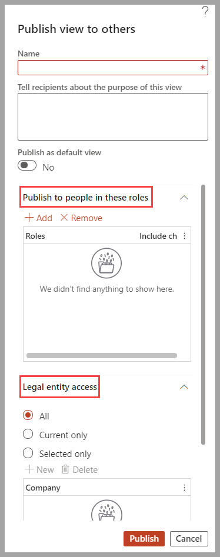

<!-- https://learn.microsoft.com/en-us/training/modules/personalize-finance-operations/11-2-saved-views -->
# Saved views

Completed

* 7 minutes

Personalization plays an important role in allowing users and organizations to optimize the user experience to meet their needs. By using the **Saved views** functionality, users can save multiple sets of personalization.

For example, a Warehouse manager needs to view the **All shipments** list page by **Site** and **Warehouse**. Instead of filtering the data daily, the Warehouse manager saves each filtered list as a view, for easy access.

**Saved views** expands on the traditional personalization in several ways, including the following:

* Unlike traditional personalization, views aren't automatically saved when a user performs personalization or filters a list.
* Views allow users to have multiple named sets of personalization to quickly switch between as needed.
* Views can include user-added filters or sorting, allowing users to return to commonly filtered datasets quickly.
* Views can be published to users in security roles and legal entities. Therefore, any user who has a specific role and access to a legal entity can access and use that view, even if they don't have permission to personalize it.
* Views can be added to workspaces as tiles, lists, or links. You can also create multiple views within a single workspace and share to other users.
* Create views on dialog pages
* Save queries on individual task pages and task double pages.

## Creating and modifying views

With the **Saved views** feature, users can create their personalized views and save them, to access later.

Views aren't automatically saved when a user personalizes the page, or when a user applies a filter to a list or sorts it. An action is required to save these changes to a **View**. This requirement gives users the flexibility to create a view before or after the changes that are associated with that view have been made.

To ensure that the current state of the view is known, when you start to change a view by personalizing or filtering it, an asterisk (\*) appears next to the current **View** name. This symbol indicates that you're looking at an unsaved, modified version of that view.

To create a new view:

1. Select the drop-down arrow attached to **Standard** view.
2. Select **Save as**.
3. Enter a view **Name** and (optionally) a **Description**.
4. Select **Save**.

## Switching between views

The top of any page that supports **Views** includes a collapsed view selector control that shows the current view's name. If you select the view name, the view selector opens and displays the list of available views for the page.

* **Standard view** - The out-of-box view of the page, where no personalization is applied.
* **Personal views** – The views without padlocks represent your personal views. These are views that either you created or that an administrator has given to you.
* **Locked views** – Some views (such as the Standard view and any views published to your role) have a padlock symbol next to them in the view selector. This symbol indicates that you can't edit those views. However, changes that reflect page usage are automatically saved. If you have personalization privileges, you can use the **Save as** action to make a personal view based on a locked view.
* **New views** – Newly released published views have a spark symbol to the left of the view name.

To switch to a different view, open the view selector, and select the view you want to load.

## Change a default view

The default view is the view that the system tries to open when you first open the page.

To change the default view for a page, follow these steps:

1. Switch to the view that you use as the default.
2. Select the view name to open the view selector.
3. Select **More** and then **Pin as default**.

Alternatively, when you create a new view (by using the **Save as** action), you can make that new view the default view by setting the **Pin as default** option before you save the view.

Other options that are available in the **Save as** field include the ability to publish to specific roles and legal entities. This means that default views can be specified for each legal entity, and personal views can be saved as global or in relation to specific legal entities.

## Supply Chain Management standard saved views

Dynamics 365 Supply Chain Management offers additional saved views. These views contain filters based on usage statistics that indicate the most popular filtering options by users of the application. These filtered views allow the user to focus on the information needed for their job and not provide distracting details that are not necessary for them.

You can further personalize these views as described above. However, we recommended that you save the personalization under a different name. When Supply Chain Management is updated, your personalization of these views will be overwritten if they are not saved under a different name.

See for [Standard saved views for Supply Chain Management](/en-us/dynamics365/supply-chain/get-started/saved-views-scm/?azure-portal=true) to see the full list of saved views that are available.