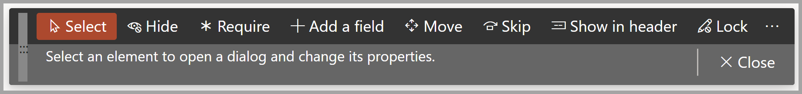

<!-- https://learn.microsoft.com/en-us/training/modules/personalize-finance-operations/7-toolbar -->
<!-- refetched: original harvest URL returned 404 -->
# The personalization toolbar

Completed

* 8 minutes

When you want to move or hide elements or make several changes, you can use the Personalization toolbar. When you select Personalize this form button, you have many options. Any personalization can be done through the **Personalization** toolbar.

If you want to make multiple changes to a page or make changes that aren't available through other mechanisms (such as reordering elements), you can use the **Personalization** toolbar. To open the **Personalization** toolbar, select **Settings > Personalize**. You can also select **Personalize this form** in the Personalize group on the **Options** tab of each page's Action Pane.

The **Personalization** toolbar can be used on any page in finance and operations apps. It allows users or administrators to customize the look and feel of any page.

The following tools are available on the **Personalization** toolbar:

* **Select** tool – Allows you to select and change the properties of an element. Select the **Select** tool, and then select the element to modify the properties of that element. A pop-up box appears with options that can also be found in the toolbar, such as **Hide**, **Required**, **Show in Header**, and **Skip**. You can repeat the process for other elements that can be personalized on that page. However, because of the way that some elements are used, finance and operations apps won't let you change some of their properties. Therefore, when you select an element, you might see that some of its properties can't be modified, or aren’t available. For example, you can't hide a field that is required.
* **Hide** tool – Hides an element on the page. Select the **Hide** tool, and then select the element to hide. When you select the **Hide** tool, all elements that are currently hidden are made visible and are shown in a shaded container. You can then unhide them. By selecting the **Select** tool, you can see how the page looks when the selected elements are hidden. For example, this could allow you to create a simplified experience for viewing by hiding required fields that default within the system.Hidden required fields are also temporarily made visible if they are empty when a save is attempted.
* **Require** tool – Makes data entry into the element of the page a requirement. When you select **Require**, all personalized elements that have been designated as required is shown in a shaded container.
* **Add a field** button – Allows you to see a list of elements that can be inserted on a page. Select the **Field** tool under **Insert** to add a field to your page. When you use the **Field** tool, you can add only fields that are part of the page definition but that aren't currently shown on the page. After you select the **Add a Field** tool, you must first select the group or area where you want to add a field. A dialog box shows the list of fields that are related to the selected group or area. In the dialog box, select one or more fields to add, and then select Insert. To remove a field that you previously added, repeat the process, but clear the selection of the field in the dialog box.
* **Move** tool – Move an element to a different location within the current group of elements. (You can't move an element outside its parent group). Select the **Move** tool, and then select the element to move. When you select an element, finance and operations apps scans the page to determine where the element can be moved. It then creates a series of "drop zones." As you drag the element around within the current group, each "drop zone" is shown as a colored, bold line next to the area where the element can be dropped.
* **Skip** tool – This tool removes an element from the page's keyboard tab sequence. When you select the **Skip** tool, all elements that are currently skipped are shown in a shaded container. You can then make them part of the tab sequence again.
* **Show in Header** tool – When you want a specific field to show up in the **Summary** section of the FastTab. When an element is selected using the **Show in header** tool, it can be selected and this causes it to appear in the **Summary** section of the FastTab.
* **Lock** tool – Designate an element as editable or noneditable. When selecting **Lock**, the noneditable elements have a shaded container around them. You then have the option to make them editable. A lock symbol appears next to the fields that are designated as noneditable.

Also on the **Personalization** toolbar is the “. . .” (More) button. Here are the actions that you can use when you select the “. . .” (More) button:

* **Add a PowerApp** – Embeds an app, that was created by using Microsoft Power Apps, into the page.
* **Clear** – This option resets the page to its default, installed state. All personalization on the current page is cleared. There is no undo action. Therefore, use this option only if you're sure that you want to reset the page.
* **Import** – Use this to load a personalization from a file that you or someone else previously created for the page. All your current personalization for the page is replaced with the personalization from the selected file.
* **Export** – Use this option to save your personalization for the page to a file. You can share your personalization with other users. Those users just import the file that contains your personalization for the page.
* **Close** – This option closes the **Personalization** toolbar and returns the page to its previous interactive state.
  When the Personalization toolbar is used, the changes are saved immediately. Your personalization takes effect as soon as you make them, and you don't have to select a Save button. In some cases, when you select a tool, a padlock symbol appears next to an element. This symbol indicates that you can't modify the element properties that are related to the selected tool, because changes to those properties prevent the page from working correctly.

## Navigating the Personalization toolbar page

When the **Personalization** toolbar is open, the current page is read-only but is much more interactive. Specifically, you can expand or collapse the FactBox pane, switch tabs, and expand or collapse sections while the **Personalization** toolbar is open in the same manner as you typically would on the page. To apply a personalization change to a collapsible section or tab (such as to hide a FastTab), select the button that appears next to the collapsible section or tab when it gains keyboard focus or when you hover over it.