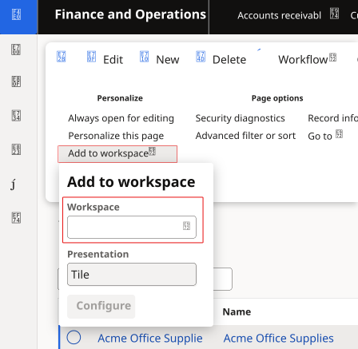
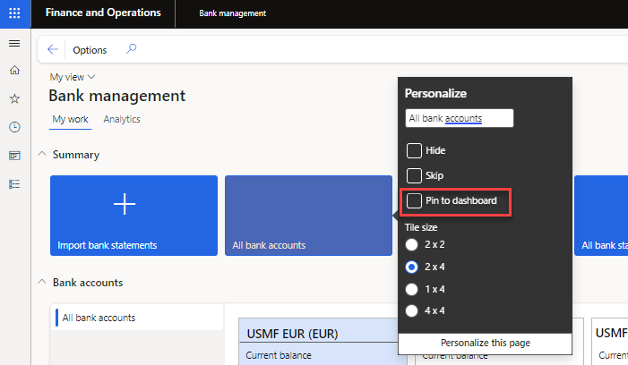

<!-- https://learn.microsoft.com/en-us/training/modules/personalize-finance-operations/8-workspace -->
<!-- refetched: original harvest URL returned 404 -->
# Personalize a workspace

Completed

* 5 minutes

For some pages that include lists, an additional personalization feature is available. The **Add to workspace** button in the **Personalize** group on the **Options** tab of the Action Pane lets you show the information from the current list in a specific workspace.

You can show a filtered and sorted view of the information in the workspace, or you can show the default view. You can also specify whether the information appears in the workspace as a list, as a summary tile that can show the number of items in the list, or as a link.

## Add a list to a workspace

To add a list to a workspace, first sort or filter the list on the page so that it shows the information as you want it to appear in the workspace. Then select **Add to workspace**. Select a workspace, and then, in the **Presentation** field, select **List**. After you select **Configure**, a dialog box appears, where you can select the columns that should appear in the list in the workspace. You can also specify the label to use for the list in the workspace.

## Add a tile to a workspace

To add a tile to a workspace, first filter the list on the page so that it shows the data that you want to be summarized or that want quick access to. Then select **Add to workspace**. Select a workspace, and then, in the **Presentation** field, select **Tile**. After you select **Configure**, a dialog box appears, where you can specify the label to use for tile in the workspace. You can also specify whether the tile should show a count. After the tile is added to the workspace, you can select it to open the current page from the workspace and view the filtered list that is associated with the tile.

## Add a link to a workspace

To add a link to a workspace, first filter the list on the page so that it shows the data that you're interested in. Then select **Add to workspace**. Select a workspace, and then, in the **Presentation** field, select **Link**. After you select **Configure**, a dialog box appears, where you can specify the label to use for the link. You can also optionally specify a label for a new section that will contain this link.

After your list, tile, or link has been added to a workspace, you can open that workspace and reorder the elements in it, as needed.

## Add a summary from a workspace to a dashboard

Some workspaces contain count tiles (that is, tiles that have numbers on them), and you might want those tiles to appear on your dashboard too. In a workspace, right-click a count tile, and then select **Personalize**. Then, in the tile's property window, select **Pin to dashboard**.

The next time that you open (and refresh) the selected dashboard, the count will appear below the navigation tile for that workspace. You can select that count to go directly to the data that it represents.

