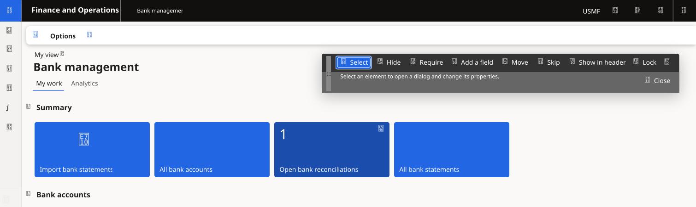
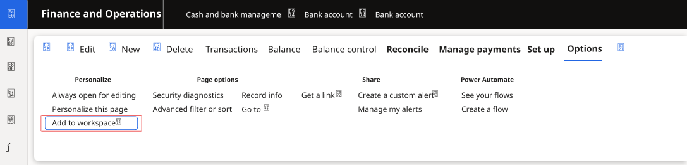

<!-- https://learn.microsoft.com/en-us/training/modules/personalize-finance-operations/9-dashboard -->
<!-- refetched: original harvest URL returned 404 -->
# Personalize a dashboard

Completed

* 5 minutes

The dashboard is often the first page that you see when you open finance and operations apps. You can personalize the dashboard so that it shows only the workspace tiles that you want to see. You can also rearrange the tiles so that they are in the order that you prefer to see them in, rename your workspace navigation tiles, or add a completely new workspace tile.

To personalize the dashboard, right-click any tile, and then select **Personalize** to open the tile's property window.

* If you want to hide or rename the selected tile, you can make that change directly in the property window.
* To reorder the workspace tiles, in the property window, select the settings icon in the upper right corner of the page > **Personalize** to open the **Personalization** toolbar. You can then use the **Move** tool to arrange the tiles as you want.

  
* To create a new workspace tile, in the property window, select **Options > Add a workspace**. A new workspace tile is created at the bottom of the dashboard. You can rename this new workspace tile if needed. You can also add lists, tiles, and links to the workspace as described in the previous unit.

  