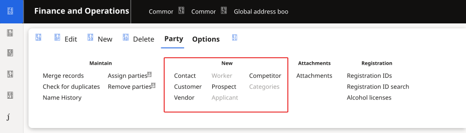

<!-- https://learn.microsoft.com/en-us/training/modules/plan-config-global-address-book-finance-operations/1-introduction -->
<!-- refetched: original harvest URL returned 404 -->
# Introduction

Completed

* 5 minutes

The global address book (GAB) is a centralized repository for master data that must be stored for all internal and external persons and organizations that the company interacts with. When an address changes, the update only needs to be made in one place. All the other associated records are updated automatically.

The global address book is included out of the box with all finance and operations apps.

The data that is associated with party records includes the party's name, address, and contact information. Other details vary, depending on whether the party is a person or an organization.

Each party record is assigned to a party, and each party can be associated with one or more party roles in a company. Party roles include customer, prospect, worker, user, vendor, competitor, applicant, and contact.

## Party roles

Roles that are associated with party records are referred to as party roles. There are several party roles, and they can be assigned to both party types, person and organization. Here are the definitions for each party role:

* **Customer** - Individuals, companies, or other entities who purchase goods and services that are produced by other individuals, companies, or entities.
* **Prospect** - A party that might provide a service or benefit to a legal entity.
* **Worker** - A person who assumes the role of an employee or a contractor, and who is paid in exchange for services.
* **Vendor** - A party that supplies products to one or more legal entities in exchange for payment.
* **Competitor** - A person or organization that provides goods or services that are similar to the goods or services that your business provides.
* **Applicant** - A person who makes a formal written or electronic request to work for or fill an open position in an organization.
* **Contact** - A person, either inside or outside your organization, that you have created an entry for. In this entry, you can save information such as the person's street and email addresses, telephone and fax numbers, and webpage URLs.

**Common > Common > Global address book**

