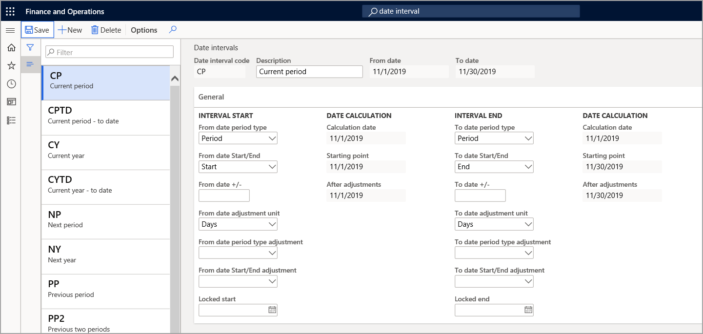

<!-- https://learn.microsoft.com/en-us/training/modules/plan-implement-legal-entities-finance-operations/11-configure-calendars -->
# Configure calendars and date intervals

Completed

* 7 minutes

There are two types of calendars in finance and operations apps.

* **Fiscal calendars** - Used in a financial management implementation and are a date control for posting financial transactions for specific period.
* **Work calendars** - Describe the capacity and working times of operations resources and set the availability of certain operations.

In finance and operations apps, you can use different calendars for different business units. For example, you can have one calendar for production and another for sales and marketing units of your business.

To define a work calendar, you need to create working time template. Working time templates define the working hours throughout a week and are used to generate working times for a period.

To create a calendar in finance and operations apps, follow these steps:

1. Go to **Organization administration > Workspaces > Resource lifecycle management**.
2. At the bottom, under **Links**, and then under **Calendars**, select **Working time templates**.
3. Select **New**
4. In the **Working time template** field, enter a value, such as 'Bus-Day'.
5. In the **Name** field, type a value, such as 'Standard Business Day'.
6. Expand the **Monday** section.
7. Select **Add**.
8. In the **From** field, enter a time, such as 8:00 AM.Specify when the workers start their workday.
9. In the **To** field, enter a time, such as 12:00 PM. Specify the time when workers break for lunch.
10. Select **Add**.
11. In the **From** field, enter the time the workers return from lunch, such as 1:00 PM.
12. In the **To** field, enter the time the workday ends, such as 5:00 PM.
13. Select **Copy day** to copy the working times definitions from Monday to Tuesday.
14. In the **To weekday** drop-down menu, select 'Tuesday'.
15. Select **OK**.
16. Select **Copy day** to copy the working times definitions from Monday to Wednesday.
17. In the **To weekday** drop-down menu, select 'Wednesday'.
18. Select **OK**.
19. Select **Copy day** to copy the working times definitions from Monday to Thursday.
20. In the **To weekday** drop-down menu, select 'Thursday'.
21. Select **OK**.
22. Select **Copy day** to copy the working times definitions from Monday to Friday.
23. In the **To weekday** drop-down menu, select 'Friday'.
24. Select **OK**.
25. Expand the **Friday** section.
26. In the **Property** field, enter or select a value.
27. Expand the **Saturday** section.
28. Select **Yes** in the **Closed for pickup** field.
29. Expand the **Sunday** section.
30. Select **Yes** in the **Closed for pickup** field.
31. Select **Save**.

## Generate working times

Calendars describe the capacity and working times of operations resources. This procedure will help you define a work calendar based on a working time template. You can walk through this procedure in demo data company USMF or using your own data.

1. Go to **Organization administration > Workspaces > Resource lifecycle management**.
2. Select **Calendars**.
3. Select **New**.
4. In the **Calendar** field, type a value, such as 'Exempt'. This is the ID of the calendar that is used as a reference when assigning calendars, such as an operations resource or a resource group.
5. In the **Name** field, type a value, such as 'Exempt calendar'.
6. In the **Standard work day in hours** field, enter a number, such as '8'.
7. In the list, select the highlighted row you just updated.
8. Select **Working times** in the Action Pane.
9. Select **Compose working times** in the Action Pane to generate working hours for each day in the period where you want to be able to schedule work. Over time, you can generate working times for additional periods.
10. In the **From date** field, enter a date, for example choose 11/1/19. This is the first day that this calendar must be open.
11. In the **To date** field, enter a date, such as 11/1/20. This is the last day that this calendar is open.
12. In the **Working time template** field, select the template you created, such as 'Bus-Day'. The working time template defines the working hours for each day of the week.
13. Select **OK**.
14. Select **Save**.
15. Close the page.

## Create date intervals

You can create and manage date intervals that can be used in financial statements and reports. Date intervals allow you to create dynamic dates. When you use date intervals, you can set up predefined periods when you run financial statements. Date intervals can also be used when setting up an allocation rule.

For example, the Controller at Contoso Entertainment USA (USMF), runs a dimension statement every month. Instead of entering the dates every time that they run the report, they select a date interval.

The date interval automatically fills in the start date and the end date. Therefore, the Controller does not have to specify the start date and end date when they run the dimension statement.

