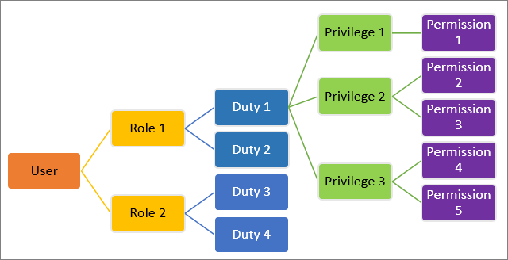

<!-- https://learn.microsoft.com/en-us/training/modules/role-security-finance-operations/2-duties-privileges -->
# Create and modify duties, privileges, and permissions

Completed

* 10 minutes

Finance and operations apps offers many duties, privileges, and permissions out of the box. If needed, you can create a new role, duty, privilege, or permission in Visual Studio.

While you can manage security roles in finance and operations apps, we recommend that you have a system administrator
manage roles or modify duties and privileges behind the scenes in Visual
Studio. Permissions can only be created or modified in the development
environment. Each role has various duties assigned to it. A privilege
can be directly assigned to a role, but it is best practice to assign a
privilege to a duty. Within each privilege, various permissions are assigned. Permissions represent the most granular access to
finance and operations apps.

Permissions represent access to individual securable objects, such as
menu items and tables. Privileges are composed of permissions, and they
represent tasks, such as generating a sales order. Privileges give the user access to perform a specific action. For example, one
privilege might have read-only access to view a record, while another
privilege grants access to create and edit a record.

Duties are composed of privileges and represent parts of a business process, such as maintaining vendor information. A single set of roles applies across all companies and organizations. An administrator no longer must create and maintain separate user groups for each company, as was the case in earlier versions. Even though roles are not specific to a
company or organization, the administrator can control access by specifying a company or organization for a user in a role.

**Example**

An accounting example can help better explain duties,
privileges, and permissions in the user interface of finance and operations apps.

In the accounting process cycle, there are the **Maintain
ledgers** and **Maintain bank transactions** duties. The **Maintain bank
transactions** duty contains the **Generate deposit slips** and **Cancel
payments** privileges. The **Cancel payments** privilege contains
permissions to the menu items, fields, and tables that are required to
cancel payments. Each permission, privilege, and duty can be reused in
other roles, duties, and privileges. For example, an Accounts payable
manager would have the same permissions as an Accounts payable clerk, but
would have additional managerial permissions as well.

## Create new roles, duties, and privileges

In Visual Studio, you can create new roles, duties, and privileges by adding an item to your project in the **Solution Explorer** window. Additionally, you can create new permissions directly through a privilege in the element designer window.

Two ways to assign duties to a role are:

* Add a new duty within the **Duties** node of the role in the element designer window.
* Select a duty from the Application Object Tree (AOT) and drag it to the **Duties** node in the element designer window.
  This same process applies to assigning privileges to roles. You can
  also create an extension of an existing role, duty, or privilege.
  This would allow you to add or remove a duty from a role, or perhaps
  change a view-only privilege to an edit privilege for a certain page
  in finance and operations apps.

Follow these steps to create a new security element:

1. In **Visual Studio**, go to the **Solution Explorer** window.
2. Right-click your project and select **Add > New Item**.
3. In the left column, under the **Dynamics 365 Items** node, select **Security**.
4. Select **Security Role**, **Security Duty**, or **Security
   Privilege**, depending on the type of element that you need to create.
5. Enter a **Name** for the security element.
6. Select **Add** to add this element to your project. The element will now be open in the element designer window.

