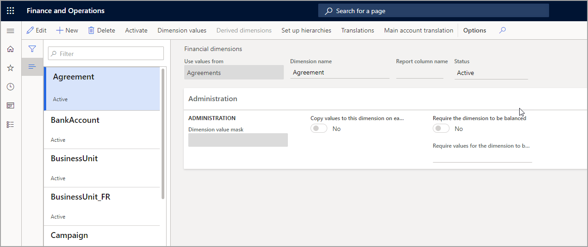

<!-- https://learn.microsoft.com/en-us/training/modules/set-up-financial-dimensions-finance/define-dimensions -->
# Define and set up financial dimensions

Completed

* 9 minutes

A financial dimension is a subaccount to the general accounts, which allows you to break down accounts into extra detail for reporting and analysis. Without dimensions, you would need to create multiple accounts for each combination of account and financial dimensions, such as department, cost center, and purpose.

Key benefits of using financial dimensions are that they:

* Provide a more detailed description of a transaction.
* Simplify the accounting process when you allow detailed analysis without needing to create a detailed chart of accounts.
* Help you analyze and classify financial transactions.
* Organize financial transactions according to voucher and account number.
* Provide extra grouping and classification options when you assign several dimensions to transactions.
* Help you view the data file from different perspectives to improve the effectiveness in tracking figures in accounts.
* Are available for use throughout Dynamics 365 Finance.

You can add dimensions to base data, such as:

* Ledger accounts
* Customers
* Vendors

Financial tags are an alternative to financial dimensions. An organization can create up to 20 user-defined financial tags and enter values for them on transactions. Tags are useful when you track values that have little or no reusability, such as sales order or purchase order numbers. Evaluate whether each value that you want to track belongs in a financial dimension or a financial tag. For more information, see [Financial tags](/en-us/dynamics365/finance/general-ledger/financial-tag/?azure-portal=true).

Use the **Financial dimensions** page to create financial dimensions that you can use as account segments for a chart of accounts.

Two types of financial dimensions are:

* **Custom dimensions** - These financial dimension types are always shared across legal entities, and users enter and maintain the values.
* **Entity-backed dimensions** - You would define the values somewhere else in the system, such as in the Customers or Stores entities. You can share some entity-backed dimensions across legal entities, whereas other entity-backed dimensions are company-specific.

After you create the financial dimensions, use the **Financial dimensions** page on the **Dimension values** tab to assign extra properties to each financial dimension. You can set options for dimension values that you can share between a chart of accounts and a legal entity. Additionally, you can set specific options for dimension values based on the chart of accounts or legal entity that you specify.

You can use financial dimensions to represent legal entities, so you don't need to create the legal entities in Finance. However, financial dimensions aren't designed for addressing the operational or business requirements of legal entities.

The intercompany accounting functionality in Finance is designed to address only the accounting entries that each transaction creates.

Before you set up financial dimensions as legal entities, evaluate your business processes in the following areas to determine whether this setup is a good fit for your organization:

* Inventory
* Sales and purchases between financial dimensions and legal entities
* Sales tax calculation and reporting
* Operational reporting

Some limitations of setting up financial dimensions as legal entities include:

* You can use sales tax functionality only with legal entities, not with financial dimensions.
* Some reports don't include financial dimensions. Therefore, to report by financial dimension, you might need to modify the reports.

## Financial dimension service

Important

Starting September 11, 2026, with the release of Dynamics 365 Finance version 10.0.49, Microsoft deprecates the Financial dimension service and aligns future investment with Optimized Financial dimensions. Don't plan new implementations around this service.

The **Financial dimension service** add-in is available in your Microsoft Dynamics 365 Lifecycle Services environment. It provides improved performance when you use the Data management framework to import a journal that has many lines. To use the service, you need to turn on the feature on the **Financial dimension service parameters** page. The service works only on imported journals. Additionally, it can process only general journals where the Ledger account type is set on the journal lines. Other account types on journal lines, such as Customer, Vendor, and Bank, aren't supported. This service isn't invoked when you set up derived dimensions in the system.

The Financial dimension service provides improved performance when you import journals by using a new service that runs in parallel to the data import. It runs only on the main account and financial dimension data in the journal. It generates the dimension combinations that you specify in the ledger account string field on the journal lines. The processing converts this string into the structured data storage that the Financial dimension framework uses throughout the rest of the product for validation, summary reporting, and inquiries.

For more information, see [Financial dimension sets](/en-us/dynamics365/finance/general-ledger/financial-dimension-sets/?azure-portal=true).