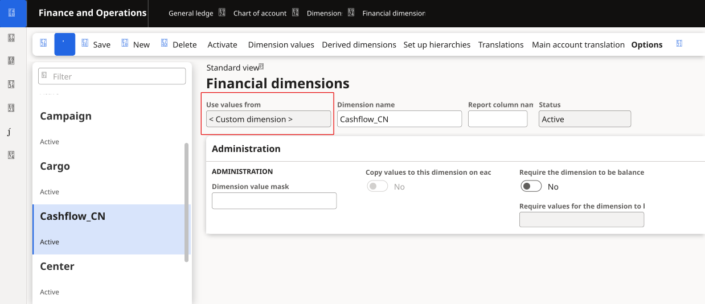

<!-- https://learn.microsoft.com/en-us/training/modules/set-up-financial-dimensions-finance/create-custom -->
# Create a custom financial dimension

Completed

* 3 minutes

To create a user-defined financial dimension, go to **General ledger** > **Chart of accounts** > **Dimensions** > **Financial dimensions**. In the **Use values from** field, select **Custom dimension**.

You can specify an account mask to limit the amount and type of information that users can enter for dimension values. You can enter characters that remain the same for each dimension value, such as letters or a hyphen (-).

You can enter number signs (#) and ampersands (&) as placeholders for characters that change whenever you change a dimension value. Use a number sign (#) as a placeholder for a number and an ampersand (&) as a placeholder for a letter. The field for the format mask is only available when you select **Custom dimension** in the **Use values from** field.

For example, if you want to limit the dimension value to the letters "CC" and three numbers, enter **CC-###** as the format mask.

For a custom dimension, you create and edit the values on the **Financial dimension values** page, where you can enter only the **Dimension value** and **Description** fields. Dimension values have a maximum length of 30 characters.