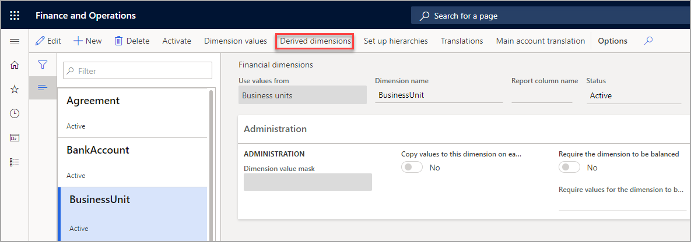

<!-- https://learn.microsoft.com/en-us/training/modules/set-up-financial-dimensions-finance/derived-dimensions -->
# Derived dimensions

Completed

* 10 minutes

You can set up a dimension so that the system automatically enters information for other dimensions when you enter that dimension in a document. For example, if you enter **cost center 10**, the system automatically enters a value of **20** in the department dimension. The dimension whose value triggers the derivation is called the *driving dimension*. In this example, cost center is the driving dimension.

You can only configure derived dimensions for dimensions that are shared across legal entities, such as Departments and Cost center. You can't configure them for company-specific dimensions, such as Project, Bank accounts, Customers, and Vendors. To check whether a dimension is shared or company-specific, go to **General ledger** > **Chart of accounts** > **Dimensions** > **Financial dimensions** and select **Dimension values**. Company-specific dimensions show the company name.

To set up derived values on the **Financial dimensions** page, follow these steps:

1. Select a dimension and then select the **Derived dimensions** tab.

   The **Derived dimensions** page includes a grid. The selected dimension segment is the first column in this grid.
2. Add the segments that you want derived. Each segment appears as a column.

   **General ledger** > **Chart of accounts** > **Dimensions** > **Financial dimensions**

   
3. Enter the dimension combinations that you want derived from the dimension in the first column.

   For example, to use the cost center as the dimension that the department and location are derived from, enter **cost center 10**, **department 20**, and **location 30**. Then, when you enter **cost center 10** in a master record or on a transaction page, the system enters **department 20** and **location 30** by default.

## Override existing values with derived dimensions

The system applies derived dimension rules after it populates default dimensions on a transaction. Therefore, a derived rule fills in a segment that the default dimensions left blank.

By default, the derived dimension process doesn't override existing values for derived dimensions.

For example, if you enter **cost center 10**, and no other dimension is entered, the system enters **department 20** and **location 30** by default. However, if you change the cost center, the system doesn't change the already established values. Therefore, you can establish default dimensions on master records, and derived dimensions don't change those dimensions.

You can change the behavior of derived dimensions to override existing values by selecting the **Replace existing dimension values with derived values** checkbox on the **Derived dimensions** page.

If you select this option, you can enter a dimension with derived dimension values. Then, those derived dimension values override values that already exist.

Using the previous example, if you enter **cost center 10**, and no other dimension is entered, the system enters **department 20** and **location 30** by default. However, if the values were already department 50 and location 60, the system changes the values to department 20 and location 30.

Derived dimensions with this setting don't automatically replace the existing default dimension values. The system only overrides dimension values when you enter a new dimension value on a page and if existing derived values for that dimension are on the page.

## Prevent changes with derived dimensions

When you use **Add segment** on the **Derived dimensions** page to add a segment as a derived dimension, an option on the **Add segment** page allows you to prevent changes to that dimension when it's derived on a page.

The default setting is off, so it doesn't prevent users from changing the derived dimension values. Change the setting to **Yes** if you want to prevent users from changing the dimension after it's derived.

For example, if the value for the **Department** dimension is derived from the value of the **Cost center** dimension, users can't change the **Department** value if the **Prevent changes** setting is **Yes**.

The setting doesn't prevent changes if the dimension value is valid, but it doesn't show in the derived dimensions list.

For example, if department 20 is derived from cost center 10, and you enter **cost center 10**, then you can't edit department 21. However, if you enter **cost center 20** and it's not in the list of derived dimensions for cost center, then you can edit the **Department** value.

In all cases, the system still validates the account value and all dimension values against the account structures after you apply the derived dimension values. If you use derived dimensions and they fail validation when someone uses them on a page, you must change the derived dimension values on the **Derived dimensions** page before you can use them in transactions.

When you change dimensions on the **Financial dimensions** FastTab, the dimension that's marked to prevent changes isn't editable. If you're entering an account and dimensions into the segmented entry control on a page, the dimensions are editable.

However, when you move the highlight off the segmented entry control and move to another field or take an action, the system validates the account and dimensions against the derived dimensions list and the account structures to ensure that you enter the appropriate values.

## Derived dimensions and entities

You can set up the derived dimension segments and values by using entities.

* The **Derived dimensions** entity sets up the driving dimensions and the segments that you use for those dimensions.
* The **Derived dimensions value** entity allows you to import the values that should be derived for each driving dimension.

When you use an entity to import data, if that entity imports dimensions, the system applies the derived dimension rules during the import unless the entity specifically overrides those dimensions.