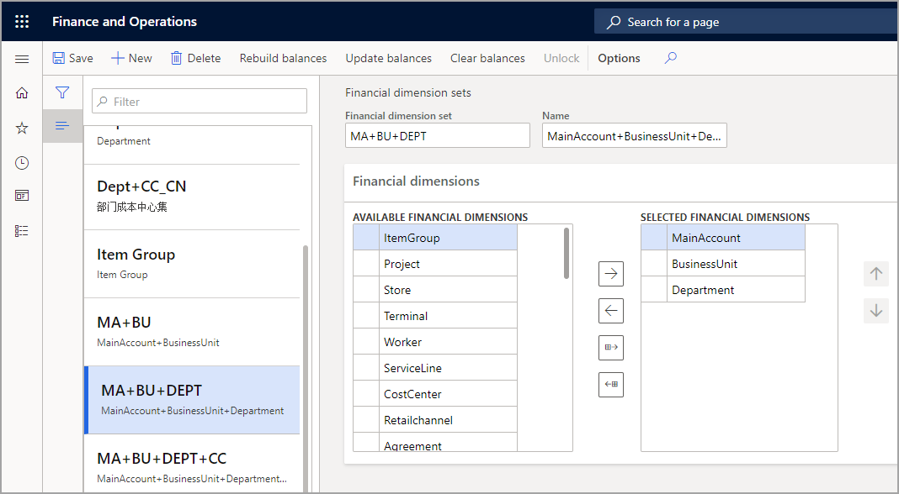

<!-- https://learn.microsoft.com/en-us/training/modules/set-up-financial-dimensions-finance/set-up-templates -->
# Set up financial dimension templates and sets

Completed

* 5 minutes

You can use financial dimension templates for common patterns that you use to distribute source document amounts.

Use the **Financial dimension default templates** page to create a template of percentage and financial dimension value combinations. The system uses the information in the template to display default financial dimension values when you distribute source document amounts.

**General ledger** > **Chart of accounts** > **Dimensions** > **Financial dimension default templates**

## Financial dimension sets

A financial dimension set contains financial dimensions or financial dimension combinations. The main reason for a financial dimension set is for reporting purposes. You can report on multiple accounts and dimension combinations.

The financial dimension sets have several purposes. You can use them to determine how the system renders reports and inquiries that are related to the general ledger. Additionally, you can use them to calculate balances during the posting process. You can schedule balances for calculation or manually update them.

The system stores balances based on the financial dimension set and calculates them based on the option to calculate with posting or batch schedule. Financial dimension sets also drive the data that the **Trial balance list** page displays.

The sequence in which the system considers financial dimension sets in reporting affects how it sorts transactions and presents fields.

For example, the **Department and Cost center** set indicates that the Department dimension type is first and Cost center is second. Therefore, the considered financial set is the composite of Department and Cost center. The system presents Department amounts first and Cost center amounts second.

**General ledger** > **Chart of accounts** > **Dimensions** > **Financial dimension sets**

You can use the defined financial dimension set alone or in pairs when inquiring or reporting on financial transactions. The system considers the selection of a primary and secondary financial dimension set when presenting the results.

The secondary financial dimension set details the figures of the primary dimension set. The selection of a secondary financial dimension set is limited to focus on those that don't share a dimension type with a primary dimension set.

Therefore, if the primary dimension set is the composite of Main account and Department, you can't select them in the secondary financial set.