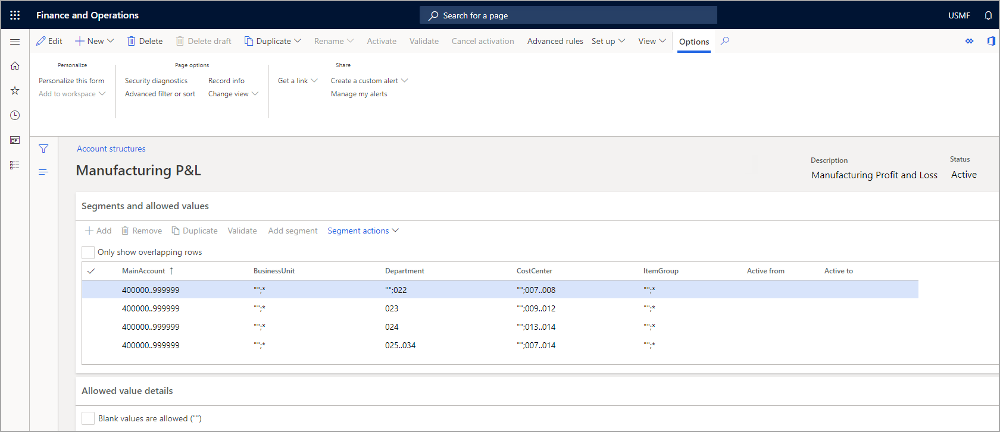

<!-- https://learn.microsoft.com/en-us/training/modules/set-up-financial-dimensions-finance/define-structure-rules -->
# Define and set up account structure and advanced rules

Completed

* 13 minutes

Account structures consist of main accounts and can include financial dimensions. You would use the account structures to define the valid combinations which, together with the main accounts, comprise a chart of accounts.

With account structures, you can define the sequence for entry on a journal of the main account and financial dimensions. It also lets you have as few or as many financial dimensions for a range of accounts as necessary.

## Set up account structures

A structure must always have at least a main account segment. Optionally, you can add more financial dimensions, which are referred to as segments on the **Configure account structures** page.

**General ledger** > **Chart of accounts** > **Structures** > **Account structures**

Having the main account as the first segment in the account structure isn't required. However, it's required to be a segment in the account structure.

Account structures use the main account and financial dimensions to create a set of rules that determine the order and values that you use when entering the account number. You can set up as many account structures as you need for your business. The account structures are assigned to a company's ledger setup, so you can share them.

Multiple account structures allow a company to track information for specific accounts while not affecting other accounts.

For example, balance sheet accounts might not require as many financial dimensions as profit and loss type accounts. For balance sheet accounts, you might only be interested in Department. For profit and loss accounts, you might also want to track Cost Center, Purpose, and Region.

The following video demonstrates how to create an account structure.

## Advanced rules

Advanced rules link a financial dimension or multiple financial dimensions to an account number or range of account numbers. As a result, you can gather more information for reporting and analysis beyond what you set up in related account structures.

Account structures and constraints allow you to build simple to complex trees of valid combinations. Occasionally, accounts in that structure need to be tracked against other financial dimensions.

For example, you have an account structure set up for profit and loss accounts that you only want to be tracked along with departments. However, a couple of profit and loss accounts also need to be tracked along with cost centers. Rather than adding the cost center dimension to the entire account structure, you can create an advanced rule to make sure that only the few accounts that need to be tracked against cost centers are set up to do so.

You shouldn't use rules to replace the use of constraints in the account structure for more dimensions that are always required regardless of the main account. Additionally, you shouldn't use rules to replicate account dimension combinations that already exist in the account structure or other rules. Any duplication automatically joins and uses the most restrictive constraint. The location of the duplicated account dimension combination only appears in the first occurrence.

When you're creating an account structure, the maximum number of segments is 11: one main account and up to 10 more financial dimensions. When a structure already has 11 segments, the **Add segment** button is unavailable. If you need more segments, then you need to thoroughly evaluate your setup and requirements because it impacts the user experience. Consider if you could derive a segment in a reporting scenario by using a hierarchy instead of during data entry or by using a user-defined field.

**General ledger** > **Chart of accounts** > **Structures** > **Advanced rule structures**

For example, if you want to report on location, but you can figure out the location by department or cost center, you wouldn't need location as a financial dimension. After evaluation, if you determine that you need more than 11 segments, you can add more segments by using advanced rules, which allow up to 16 total segments.

Advanced rule structures provide the financial dimension combinations that are valid for the advanced rule.

For example, you want to track the travel expense account by airline. You could set up **Travel Expense** as the main account and then create another financial dimension called **Airlines**. Then, you can set criteria for that financial dimension, such as **Airline 1**, **Airline 2**, and **Airline 3**. Now, you can track travel expenses by each defined airline.

To add or edit advanced rules for an account structure, you need to make sure that the account structure is in a draft status. If the account structure is active, and you select to create a new advanced rule or edit an existing advanced rule, you receive a message and can change the status of the account structure from active.

As previously mentioned, account structures require the main account. The main account doesn't need to be the first segment in the structure, but it identifies the account structure that's being used during the account number entry. Therefore, a main account value can only exist in one structure that's assigned to the ledger so that they don't overlap.

After you define the account structure, the system filters the allowed values list to guide the user through picking only valid dimension values, which decreases the possibility of an incorrect journal entry.

The following video demonstrates how to create an advanced rule structure.

If you plan to budget against a financial dimension, it must be part of an account structure. Budgeting doesn't use advanced rules.

When setting up your account structures, we recommend that you follow a few best practices. However, these best practices are only guidance, so you should consider a holistic discussion about your business, growth plan, and maintenance.

* Make the main account first, or as close to the front of the account structure as possible. That way, users get the best guided experience that they can during account entry.
* Reuse account structures as much as possible to reduce maintenance across your legal entities.
* Consider using advanced rules so that you can reuse account structures for variations across legal entities.
* Use ranges and wildcards as much as possible when you're defining allowed values. This approach allows you to grow and change without maintenance, and the system also performs more ideally with this configuration. Don't put a wildcard inside a range, such as `100*..399*`. A range must specify two string values of the same length, such as `100000..399999`. Use wildcards with the **Begins with**, **Ends with**, or **Is like** operators instead.
* Don't enter an asterisk for every segment in the account structure and then solely rely on the advanced rules. This approach can be difficult to manage and often leads to user error during maintenance that can make the system unable to post.

## Activate an account structure

When you're satisfied with your new setup or change to an account structure, you need to activate it. If you assign an account structure to a ledger, this activation can be a long-running process because you must sync all unposted transactions in the system to the new structure. Account structure changes don't affect posted transactions.

**General ledger** > **Chart of accounts** > **Structures** > **Configure account structures**

With the **Account structure activation performance** feature, you can update multiple transaction groups faster by running them simultaneously during account structure changes. The structure is marked as **Activated** after the system validates it.

The **Validate** button performs a limited check and can pass even when overlapping criteria exist. The system runs full overlap detection only during activation, when it builds all possible tree paths, so validation isn't a substitute for activation.

Because transaction updates might take some time, you can track the status of your activation by selecting **View activation status** above the grid on the **Account structure** page. You can also view your activation status by selecting **View** on the Action Pane and then selecting **Activation status** from the dropdown menu. After you select **View activation status**, a dialog appears that shows the individual tasks that are running as part of the activation process. For each task, you can view the status and, after the task is completed, the completion date and time.

For more information, see [Account structure activation performance enhancement](/en-us/dynamics365/finance/general-ledger/account-structure-improvement/?azure-portal=true).