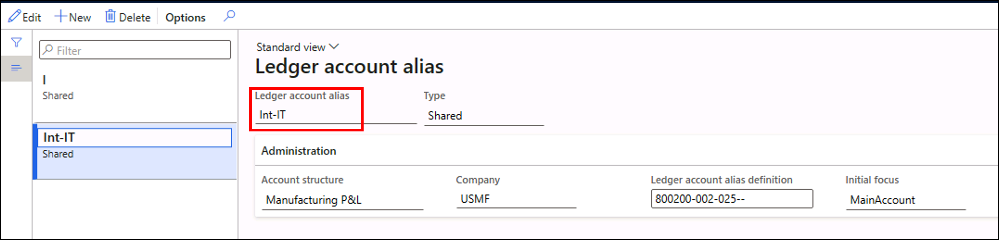

<!-- https://learn.microsoft.com/en-us/training/modules/set-up-financial-dimensions-finance/ledger-account-aliases -->
# Ledger account aliases

Completed

* 4 minutes

In most organizations, the account structure in General ledger is a combination of the main account and several financial dimensions. You need to populate the account and all required dimensions in the journal lines. The more dimensions that you have, the more tedious the journal line creation becomes.

**Ledger account alias** is primarily a usability feature. It simplifies the journal line creation by making a short alphanumeric value instead of the entire main account and dimension combination. You can define this alphanumeric value on the **Ledger account alias** page under **Chart of accounts > Accounts** sub menu of the **General ledger** module. This feature is useful for commonly used account combinations.

The **Type** field defines to whom this alias is available. If the value is **Shared**, this alias is available to all users. If you select **User group** in the **Type** field, you are asked to select the user group. The users in the selected group are eligible to use the ledger account alias. You can also select **User** in the **Type** field, where you are asked to select the user who's eligible to use the ledger account alias.

In the **Initial focus** field, you need to choose the dimension that should be selected when you enter the ledger account alias in the journal line.

In the **Account** column of the general journal line, you can enter the ledger account alias.

When you leave the field, the application automatically picks up the actual account and dimensions.

You can further update the account and dimensions according to business requirements.