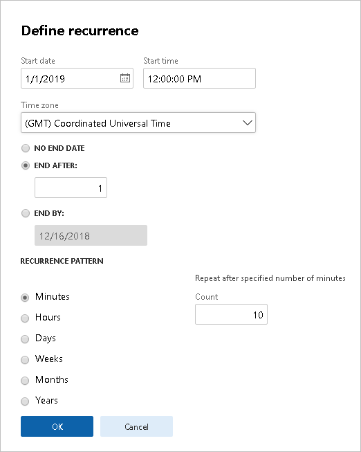
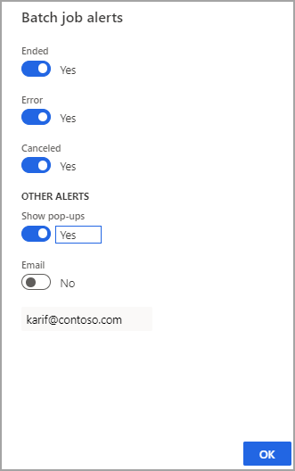

<!-- https://learn.microsoft.com/en-us/training/modules/setup-batch-jobs-finance-operations/3-reports-alerts -->
<!-- refetched: original harvest URL returned 404 -->
# Batch processing of reports and setup of alerts

Completed

* 8 minutes

In finance and operations apps, any of the reports or actions can be set to run as a batch job by going to the **Run in the background** section of the report's parameter pane. Set **Batch processing** to **Yes**, then provide a batch task job name, batch group, and whether the job should run as Private or Critical. The report will then be created when the batch task runs.

You can set up recurrence patterns for batch jobs. For example, you can set up a job to process invoices automatically at the end of every month.

What you see below is the dialog box on most reports in the system if you select **Run in the background** when you select a report.

To monitor batch jobs, you can set up alerts. Alerts can be sent when the batch job succeeds, fails, or has finished running.

After a batch job has been processed, you can view the history. The history includes any messages that were encountered while the job was running.

Watch this video to learn more about batch job reports.

## Batch priority based scheduling

You can turn on the **Batch priority-based scheduling** feature in the **Feature management** workspace. Priority-based scheduling decouples batch groups from the batch server and allows you to define priorities for batch groups. You don’t have to assign batch jobs to batch servers. Instead, you can use relative scheduling priorities based on business requirements are used to determine the order in which tasks are run across available batch servers.

A scheduling priority is defined for batch groups, but it can be overridden for specific batch jobs. The scheduling priority classifications are used to declare relative priorities, and to determine the processing order of jobs and business processes. The priorities that can be used when using this function are **Low**, **normal**, **High**, **Critical**, and **Reserved capacity**.

To learn more about how to set up priority based batch scheduling, see [Priority-based batch scheduling](/en-us/dynamics365/fin-ops-core/dev-itpro/sysadmin/priority-based-batch-scheduling/?azure-portal=true)