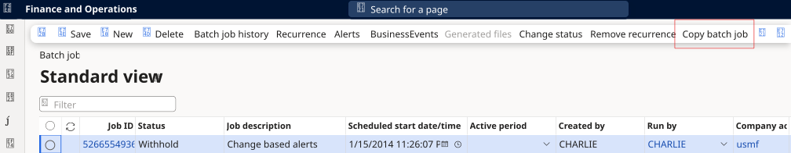

<!-- https://learn.microsoft.com/en-us/training/modules/setup-batch-jobs-finance-operations/4-copy-a-batch-job -->
# Copy a batch job

Completed

* 2 minutes

When you want to create the same jobs for different legal entities, you can use the **Copy batch job** functionality to copy an existing batch job and the batch tasks, including recurrences.

You can set the description, company, schedule start date and time, the recurrence, and the run by account at the same time. When you copy the batch job, any alerts and dependencies from the source job will also be copied.

**System administration > Inquiries > Batch jobs**

