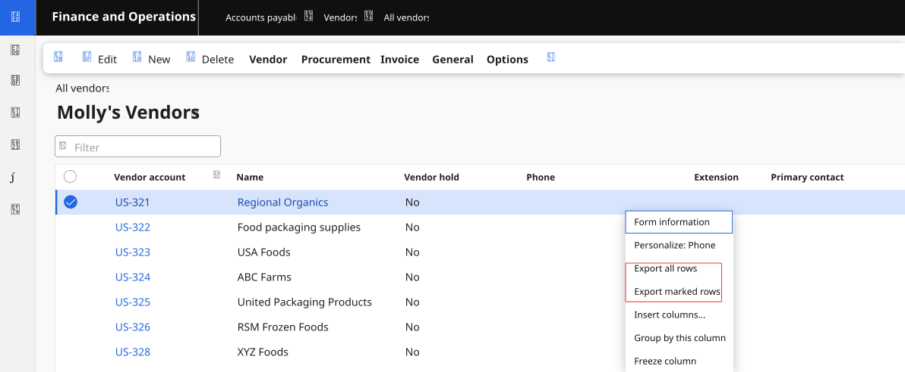

<!-- https://learn.microsoft.com/en-us/training/modules/work-analytics-reporting-finance-operations/2-types -->
<!-- refetched: original harvest URL returned 404 -->
# Understand different types of reports and inquiries

Completed

* 10 minutes

The first step in working with the reporting functionality in finance and operations apps is to understand the reporting features that already exist and that you can use, either as they are, or through small extensions to match your customer requirements.

Finance and operations apps provide several reporting tools that cater to various data access scenarios.

For example, the needs of users when they are interacting with business documents differ greatly from scenarios where they want to explore data at an aggregate level or derive insights by using Artificial Intelligence models that are hosted in the cloud.

Finance and operations apps provide specialized tools for reporting experiences:

* **Embedded analytics and native controls** - Built-in visualizations that are used in operational reports to aggregate data to workspaces, by using native controls such as charts and grids.
* **SQL Server Reporting Services (SSRS)** - Primarily used for business documents and high-volume printing scenarios that are common with invoices, packing slips, picking lists, and more.

  Many pre-generated SSRS reports come out of the box with finance and operations apps. SSRS reports allow you to print reports to different locations, such as your screen, printer, a file, or an email. You can use SSRS reports to create parameterized views with drill-down navigation. You can also embed hyperlinks from a report to finance and operations apps pages.
  Additionally, you can schedule your reports to run periodically by using a batch job. SSRS reports can also help you create precise compliance documents for your local regulatory business. In addition to the out-of-the-box reports, you can create and modify additional reports by using X++ development to suit your organization's needs.
* **Financial Report Designer** - Flexible tool that is used to customize and create financial statements such as balance sheets, income statements, and cashflow statements.
* **Microsoft Power Platform** - Includes dashboards and workspaces that contain predefined and personalized views, Power BI, Power Apps, and Power Automate integrations.
* **Electronic reporting** - Used to configure formats for incoming and outgoing electronic documents in accordance with the legal requirements of various countries or regions. Electronic Reporting lets you manage these formats during their lifecycle.
  For example, you can adopt new regulatory requirements, and generate business documents in the required format to electronically exchange information with government bodies, banks, and other parties.

  The Electronic reporting engine is targeted at business users instead of developers. Because you configure formats instead of code, the processes for creating and adjusting formats for electronic documents are faster and easier.

  See [Electronic reporting (ER) overview](/en-us/dynamics365/fin-ops-core/dev-itpro/analytics/general-electronic-reporting/?azure-portal=true) to learn more.

## Microsoft Office integrations

By using the Microsoft Office integration built-in feature, you can export selected, or all, rows from a list page grid and export data entity values into a Microsoft Excel workbook for reporting purposes. Then, you can use the rich capabilities of Excel, such as pivot table, charts, and more, to present your data.

Finance and operations uses the Excel Data Connector to view, update, and edit data within an Excel workbook. You will need to download the Microsoft Dynamics Add-in to use this feature. On some pages, you can select the **Open in Office** icon on the Action Pane.

From there, you can select **Open in Excel** or **Export to Excel**.

* **Open in Excel** - Lets you use the data entity that is related to the form data. The columns that appear on your Excel workbook are defined in the **AutoReport** field group on the entity. You can also add or remove fields from the entity by using the **Design** button. Additionally, you can filter the data by using the **Filter** button. The **Open in Excel** feature also gives you the ability to change the data in the grid and publish the changes back to finance and operations apps.
* **Export to Excel** - Exports all the grid data to an Excel workbook. When the data is in a workbook, you can use the tools in Excel to manipulate the data and create visual charts for your reporting needs.

## Financial reporting

Standard financial reports are provided by using the default main account categories in finance and operations apps. Use the Report designer to create or modify traditional financial statements, such as the Income statement and Balance sheet, and share the results with other members of your organization.