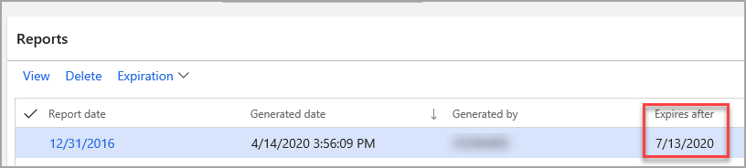

<!-- https://learn.microsoft.com/en-us/training/modules/work-analytics-reporting-finance-operations/3-financial-reporting -->
# Financial reporting

Completed

* 20 minutes

Financial reporting allows financial and business professionals to create, maintain, and view financial statements. It moves beyond traditional reporting constraints to help you efficiently design various types of reports.

Financial reporting includes dimension support to determine what financial dimensions you want to include, and the sequence, and enables the building of a custom reporting structure.

You can map the following to gain better insight of financial data:

* Main accounts
* Financial dimensions
* Combinations of the two

For example, you can create financial row structures to focus on cost accounts. You can set up unlimited financial dimensions that allow for cost detail.
The following financial dimensions are examples that might be associated with cost accounts:

* Cost centers
* Departments
* Combinations of the two

The Financial reporting database is deployed to its own SQL Azure database on the same SQL Azure service as the finance and operations apps instance. This means that the database is preconfigured when you deploy finance and operations apps, and automatically links to available databases so that the Financial report designer can connect to it.

## Report designer

By using Report designer, you will be able to:

* Save and reuse dimension combinations for multiple reports.
* Control how to format and display the dimension descriptions.
* Identify the accounts or dimensions that have been omitted from report building blocks.
* Format the headers for rolling forecasts.

You can manage the generation and distribution of reports by using the following features:

* Scheduling reports so that they are automatically generated on a daily, weekly, monthly, or annual basis.
* Exporting the report result to the read-only PDF format, which provides better document security through digital signatures.
* Exporting to a Microsoft Excel worksheet.

Interactive features let you perform the following tasks within Financial reporting:

* Change the report date for the report that you're viewing.
* Change the currency of the report that you're viewing.
* View the report in either a summary view or a detailed view.
* Add dimension filters to limit the report content to a specific dimension or combination of dimensions.
* Add attribute filters to limit the report content to a specific attribute or a combination of attributes.

We recommend that you link your main accounts to your main account categories. This makes it easier and faster when setting up your reporting in Financial reporting.

For example, if you are creating a report, rather than listing many main accounts, you can simply list your main account category and get a total of all the main accounts in that category.

## Accessing financial reporting

Before creating and generating the financial reports, ensure that the following items have been set up for your company:

* Currency
* Fiscal calendar
* Chart of accounts
* Ledger

For more information, see the following Microsoft Learn documentation and training content:

* [Fiscal calendars, fiscal years, and periods](/en-us/dynamics365/finance/budgeting/fiscal-calendars-fiscal-years-periods/?azure-portal=true)
* [Plan your chart of accounts](/en-us/dynamics365/finance/general-ledger/plan-chart-of-accounts/?azure-portal=true)
* [Configure currencies in Dynamics 365 Finance](/en-us/training/modules/configure-currencies-dyn365-finance/?azure-portal=true)
* [Create fiscal calendars, years, and periods in Dynamics 365 Finance](/en-us/training/modules/create-fiscal-calendars-years-periods-dyn365-finance/?azure-portal=true)
* [Configure chart of accounts in Dynamics 365 Finance](/en-us/training/modules/configure-chart-accounts-dyn365-finance/?azure-portal=true)
* [Configure ledgers and journals in Dynamics 365 Finance](/en-us/training/modules/configure-ledgers-journals-dyn365-finance/?azure-portal=true)

You can find the **Financial reporting** menu in the following locations in Dynamics 365 Finance:

* **General Ledger > Inquiries and reports**
* **Budgeting > Inquires and reports > Basic budgeting**
* **Budgeting > Inquiries and reports > Budget planning**
* **Budgeting > Inquiries and reports > Budget control**
* **Consolidations**

## Financial reporting setup

The **Financial reporting setup** page in **General ledger > Ledger setup** has a list of all financial dimensions in the system. It has two sections that determine the data that you will report on in Financial reporting:

* **Dimensions tab** - Because different companies use different dimensions and account structures, there is no way to determine the order in which users want to view all financial dimensions on reports. This page allows you to set the order in which you want financial dimensions to appear when you build and view a report in Financial reporting.
* **Attributes tab** - This is where you can select whether you want to use vendors and customers as attributes for filtering and report design. Reporting on vendor and customer will only be valuable if you do not enter multiple vendors or customers in a single voucher when posting transactions. Selecting **Vendor** and/or **Customer** will add more time to the integration.

## Financial reporting components

The following components of financial reporting make it easy to create, view, and schedule reports:

* **Report designer** - Create report building blocks that can be combined to define and generate a report. Advanced users can create new report building blocks or modify existing building blocks to meet their requirements.
* **Report schedules** - Schedule a single report, or a group of reports, so that it is generated on a regular basis.

The financial statement functionality simplifies your ability to build reporting structures for internal analytical purposes. You can create many financial reports to comply with requirements and international accounting standards.

There are two default balance sheet reports:

* **Balance Sheet – Default** - The sections are stacked. Provides a view of the organization's financial position for the year.
* **Side by Side Balance Sheet – Default** The sections are side by side. Provides a view of the organization's financial position for the year. Assets and liability and shareholder’s equity are side by side.

The three trial balance reports are:

* **Detailed Trial Balance – Default** - Provides balance information for all accounts, and includes debit and credit balances, and the net of these, together with the transaction date, voucher, and journal description.
* **Summary Trial Balance – Default** - Provides balance information for all accounts and includes opening and closing balances, and debit and credit balances, together with their net difference.
* **Summary Trial Balance Year Over Year – Default** - Provides balance information for all accounts and includes opening and closing balances, and debit and credit balances, together with their net difference for the current year and the past year.

The **Income Statement – Default** report provides a view of the organization’s profitability for the current period and for the year to date.

## Financial report retention policies

As you run Financial reports, default expiration dates are applied to each one to automatically delete them after a period of time. Any reports can be retained for regulatory purposes, however, by using the Expiration feature in Financial reports. You have two choices:

* 90 days
* Never

## Row definition

A row definition is a report component, or building block, that specifies the contents of each row on a financial report. It can be combined with column definitions, reporting tree definitions, and report definitions to create a building block group that can be used by multiple companies.

A row definition defines the descriptive lines (for example, salaries or sales) on a report. It also lists the segment values or dimensions that contain the values for each line item and includes row formatting and calculations.

You can use row definitions in the financial statements to present financial figures by the following:

* Financial dimension
* Main accounts
* A combination of the two

A row definition can contain up to 20,000 financial dimension rows and can include the following information:

* Descriptive text that adds meaning to the report by creating section headings, lines, and spaces, such as Cash or Total revenue.
* Links to financial data, which can include dimension values in finance and operations apps.
* Row totals and formulas that are based on the linked financial data.

Usually, each row in a row definition contains one of the following types of information:

* References to the financial dimensions system.
* Totals or calculations that are based on the data.
* Formatting.

Two methods for entering information in a row definition are:

* **Manually** - Enter row information in a new row definition. For more information, see [Modify row definition cells](/en-us/dynamics365/fin-ops-core/dev-itpro/analytics/modify-row-definition-cells-financial-reporting?azure-portal=true&toc=%2Ffin-and-ops%2Ftoc.json).
* **Use the Report designer** - Use this to pull row information directly from the financial dimensions.

You can set up a row definition to pull data from the financial dimensions system every time that the report is generated.

A dimension is an intersection of data and values. You can group data and values in the Report designer. Then, you can classify and analyze transactions in more detail. You can use the **Insert rows** function from **Dimensions** dialog box to add multiple rows to a row definition at the same time.

The following list describes the information that you can specify for each dimension:

* **Dimension** - The pattern that identifies the dimension to add to the row definition. This pattern contains one ampersand (&) or number sign (#) for each position in the dimensions. If a dimension has an ampersand, then that dimension will populate the row definition. By default, it's set on the main account, which is the most common way to build a row definition.
* **Dimension Range Start** - The first value for this dimension to add to the row definition.
* **Dimension Range End** - The last value for this dimension to add to the row definition.

## Column definition

A column definition is a report component, or building block, that defines the contents of columns on a report. Like row definitions, basic column definitions can be used on multiple reports.

A column definition defines the period to use when data is extracted from the financial dimensions. It also includes column formatting and calculations. You can also restrict a report column to a specific unit or for specific dates.

Often, you might need to combine financial dimension sets to make detailed financial reports, which match the customer’s requirements. This helps companies to analyze transactions from the following transactions:

* General ledger
* Budget

You can add, modify, and delete the headers that appear at the top of the columns on a report. You can also configure conditional spanning column headers, based on the **Period** field from column definitions and the **Base period** field from report definitions. The base period feature helps save time when you create rolling forecast reports.

## Reporting tree definition

A reporting tree definition helps define the structure and hierarchy of your organization. It's a cross-dimensional and cross-company hierarchical structure that is based on the dimensional relationships in your financial data. It provides information at the reporting unit level and at a summary level for all units in the tree.

Reporting tree definitions can be combined with column definitions and report definitions to create a building block group that can be used by multiple companies.

A reporting unit can be an individual department from the financial data, or it can be a higher-level summary unit that combines information from other reporting units. For a report definition that includes a reporting tree, one report is generated for each reporting unit and for the summary level.

Financial reports that aren't based on a reporting tree use only some of the capabilities of Financial reporting. You can use multiple reporting tree definitions together with the same row and column definitions to view your organization's data in various ways.
All these reports use the row and column definitions that are specified in the report definition, unless the report definition specifies that the reporting tree from the row definition should be used. Row and column definitions are important components in the design and functionality of financial reports.

## Security considerations

You can create a password to lock and help protect a building block. In this way, you can add a level of security to a report component without securing the whole system.

A password can help protect building block information that is important to your month-end reporting process.
A user in any role can lock a building block. However, other users always have read-only access to a locked component. Users can open, change, and save the locked component under a new name.
A user who has the role of administrator can always access and change a locked building block.

## Learn more

For more information about financial reports, see [Get started with Financial reporting](/en-us/dynamics365/finance/general-ledger/financial-reporting-getting-started/?azure-portal=true)